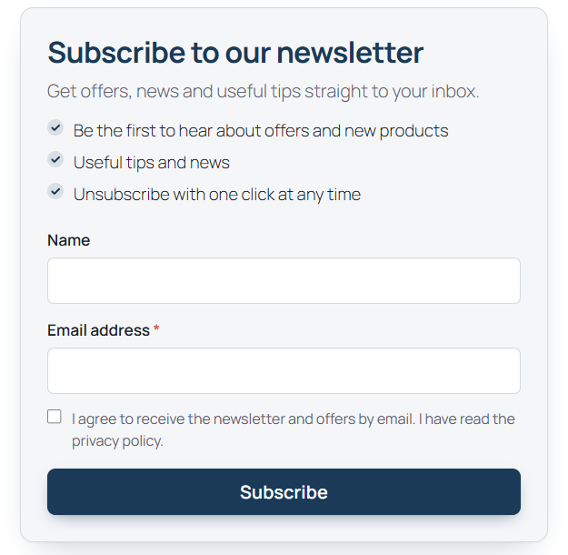
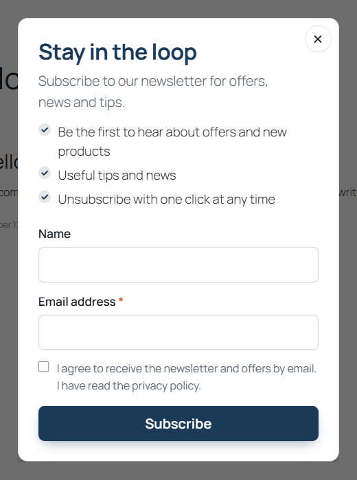
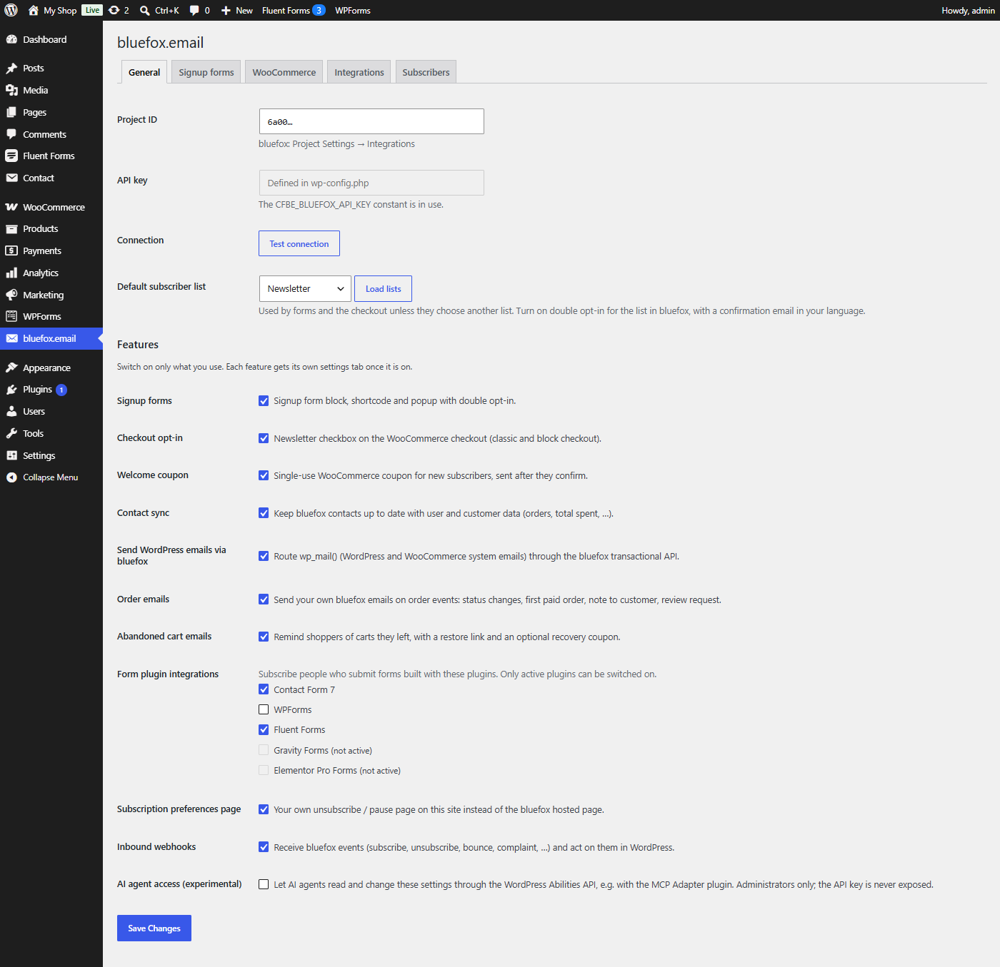

# Connector for bluefox.email – Newsletter and WooCommerce Marketing

A WordPress plugin that connects your site and WooCommerce store to [bluefox.email](https://bluefox.email): signup forms with double opt-in, a WooCommerce checkout opt-in with a welcome coupon, order and abandoned cart emails, contact sync and `wp_mail()` delivery.

Every feature is a module you switch on or off, so the plugin only loads what you use.

**Documentation: https://beamkiller.github.io/connector-for-bluefox-email/**

<p>
  
  
</p>



## Features

- **Email templates** – ready-made, mobile-friendly bluefox emails (confirmation, welcome coupon, first order thank-you, review request, abandoned cart reminder) created in bluefox with one click and wired up automatically – no copying of email IDs. They match your WooCommerce email design.
- **Signup forms** – block, `[cfbe_form]` shortcode, compact `[cfbe_promo]` bar and a popup with scroll, delay, exit-intent and page-view triggers, page targeting and frequency rules. Double opt-in is handled by your bluefox list.
- **Tags and interests** – every signup is tagged by source and placement; an optional interests field adds one tag per choice.
- **Checkout opt-in** – an unticked newsletter checkbox on the classic and block checkout, and optionally on My Account.
- **Welcome coupon** – a single-use WooCommerce coupon locked to the subscriber's email, created only after they confirm, one per email address (and by default one per mailbox).
- **Order emails** – your own bluefox emails on order status changes, first paid order, customer notes and review requests.
- **Abandoned cart emails** – reminders with a restore link and an optional single-use recovery coupon.
- **Contact sync** – user and customer data (order count, total spent, last order date, …) on bluefox contacts for segmentation, with bulk backfill and WP-CLI.
- **Email delivery** – route `wp_mail()` through the bluefox transactional API, with a test button and fallback.
- **Form plugin integrations** – Contact Form 7, WPForms, Fluent Forms, Gravity Forms and Elementor Pro.
- **Preferences page** – your own translatable unsubscribe / pause page instead of the bluefox hosted page.
- **Inbound webhooks** – bluefox subscription, bounce and complaint events stored in WordPress, with developer hooks.
- **AI agent access (experimental)** – read and change the settings through the WordPress Abilities API, for example with the MCP Adapter plugin.
- **Privacy tools** – consent records, IP address modes and retention, personal data export and erasure.
- Page-cache friendly (no nonces in public forms), accessible markup, English and a complete **Hungarian (magyar) translation** included – set the site language to Magyar and the plugin, its forms and its ready-made emails are in Hungarian.

## Requirements

| | Version |
|---|---|
| WordPress | 6.7 or newer (6.9+ for AI agent access) |
| PHP | 8.1 or newer |
| WooCommerce | optional, 9.0 or newer – HPOS and the block checkout are supported |
| bluefox.email | an account with a project and an API key |

## Install

**From WordPress.org** – planned. Once listed, search for *Connector for bluefox.email* under **Plugins → Add New**.

**From a zip** – download the zip from [Releases](https://github.com/beamkiller/connector-for-bluefox-email/releases) (or **Code → Download ZIP**), then upload it under **Plugins → Add New → Upload Plugin** and activate it.

**With git**

```bash
cd wp-content/plugins
git clone https://github.com/beamkiller/connector-for-bluefox-email.git
wp plugin activate connector-for-bluefox-email
```

The repository root is the plugin; there is no build step.

## Quick start

1. Open **bluefox.email → General**, enter your project ID and API key (or define `CFBE_BLUEFOX_API_KEY` in `wp-config.php`) and click **Test connection**.
2. Click **Load lists** and choose the default list.
3. In bluefox.email, turn on double opt-in for the list, choose its confirmation email (with `{{verifyLink}}`) and set its redirect link to your thank-you page.
4. Switch on the features you need under **Features** and configure each one on its tab.
5. Add the **bluefox.email signup form** block or `[cfbe_form]` to a page, create the thank-you page with `[cfbe_thankyou]`, and click **Register webhook in bluefox** on the Webhooks tab.

The [Getting started guide](https://beamkiller.github.io/connector-for-bluefox-email/getting-started/) walks through each step.

## Privacy

This plugin sends data to the external **bluefox.email API** (`https://api.bluefox.email`): email addresses, names, tags and lists of people who sign up, and – depending on the features you turn on – customer data, order and cart details and the emails sent with `wp_mail()`. Nothing is sent before you enter your project ID and API key. See the bluefox.email [terms of use](https://bluefox.email/terms-of-use) and [privacy policy](https://bluefox.email/privacy-policy), and the [privacy page of the docs](https://beamkiller.github.io/connector-for-bluefox-email/help/privacy/).

## License

GPL-2.0-or-later. See [LICENSE](LICENSE).

Developed by [Peter Kulcsár - KREMONT s.r.o.](https://www.linkedin.com/in/peterkulcsar/). This plugin is not developed by or affiliated with bluefox.email.
