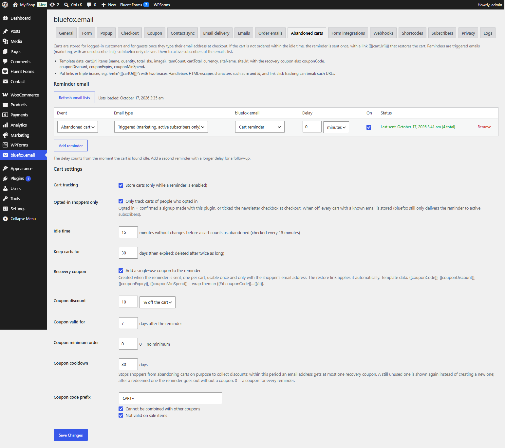

# Abandoned cart emails

Switch: **Abandoned cart emails** (needs WooCommerce). Settings: [Abandoned carts tab](../settings/abandoned-carts.md).



Remind shoppers of carts they left. The reminder contains a link that restores the cart and, optionally, a single-use recovery coupon.

## Set it up

1. In bluefox create a **triggered** email for the reminder (it is a marketing email with an unsubscribe link). Use `{{{cartUrl}}}` for the restore button.
2. On the **Abandoned carts** tab click **Refresh email lists**, then **Add reminder** and choose the email.
3. Set a **Delay** if needed and save. Add a second reminder with a longer delay for a follow-up.

Reminders can only use triggered emails, so bluefox delivers them only to **active subscribers** of the email's list.

## Which carts are stored

Carts are stored only while **Cart tracking** is on and at least one reminder is enabled.

- **Logged-in customers** – on every cart change.
- **Guests** – once they type their email address at checkout. On the classic checkout a small script sends the email to `POST /wp-json/cfbe/v1/cart-email`; on the checkout block the plugin listens to the Store API customer update.
- **Opted-in shoppers only** (default on) – only people who confirmed a newsletter signup made with this plugin (form, checkout or form plugin). A ticked but unconfirmed checkout box does not count. When off, every cart with a known email is stored.
- A cart row is only updated by the shopper's own session. If an open cart of another session already uses the address, it is not stored again, so typing someone else's address cannot take over their cart.
- `cart-email` requests are limited to 20 per IP per 10 minutes and 5 per mailbox per hour.

Carts live in the `{prefix}cfbe_carts` table. The tab lists the 20 most recent ones.

## When a reminder goes out

1. Every 15 minutes a background job looks for carts with no change for the **Idle time** (default 60 minutes, 15–10080).
2. An idle cart is marked `sent` and its reminders are queued with their delays. Each cart is reminded once.
3. Just before sending, the cart is checked again. If the shopper ordered in the meantime, nothing is sent.

| Cart status | Meaning |
|---|---|
| `open` | stored, not idle yet |
| `sent` | reminder queued or sent |
| `recovered` | ordered after opening the restore link |
| `ordered` | ordered without the link |
| `expired` | older than **Keep carts for** (default 30 days); deleted after twice as long |

## The restore link

`{{{cartUrl}}}` looks like `https://your-site.example/?cfbe_cart_<token>`. It has no `=` or `&` on purpose, so email click tracking cannot cut it. Opening it:

- empties the current cart and adds the stored products again, skipping products that are no longer purchasable or in stock;
- applies the recovery coupon, if there is a usable one, and pre-fills the guest's checkout email with the cart's address;
- redirects to the cart page. An invalid or used link shows *This cart link is no longer valid.*

The link is the credential (32 random characters) and is rate limited.

## Recovery coupon

Tick **Recovery coupon → Add a single-use coupon to the reminder**.

| Property | Value |
|---|---|
| Created | when the reminder is sent, one per cart |
| Code | **Coupon code prefix** (default `CART-`) + 8 random characters, e.g. `CART-K7M2QX9P` |
| Discount | **Coupon discount**, % or fixed amount off the cart (default 10 %) |
| Usage limit | 1, and 1 per user |
| Allowed emails | only the cart's email address |
| Expiry | end of the day, **Coupon valid for** days after the reminder (default 7) |
| Options | **Coupon minimum order**, *Cannot be combined with other coupons* (default on), *Not valid on sale items* (default on) |

**Coupon cooldown** (default 30 days) stops shoppers from leaving carts on purpose to collect discounts. Within this period an email address gets at most one recovery coupon:

- a still unused coupon is offered again in the next reminder;
- after a used or expired one, the reminder goes out without a coupon;
- `0` creates a coupon for every reminder.

If the coupon cannot be created, the reminder is still sent – without coupon data. Always wrap the coupon part of your template:

```handlebars
{{#if couponCode}}
  <p>Use <strong>{{couponCode}}</strong> for {{couponDiscount}} off until {{couponExpiry}}.</p>
{{/if}}
<a href="{{{cartUrl}}}">Back to your cart</a>
```

## Template data

`cartUrl`, `items` (`name`, `quantity`, `total`, `sku`, `image`), `itemCount`, `cartTotal`, `currency`, `siteName`, `siteUrl`, and with the recovery coupon `couponCode`, `couponDiscount`, `couponExpiry`, `couponMinSpend`. See [Email template data](../developers/template-data.md).

## Privacy

Stored carts are included in the WordPress personal data export and erased by the personal data eraser (**Tools → Export / Erase Personal Data**). See [Privacy and GDPR](../help/privacy.md).
