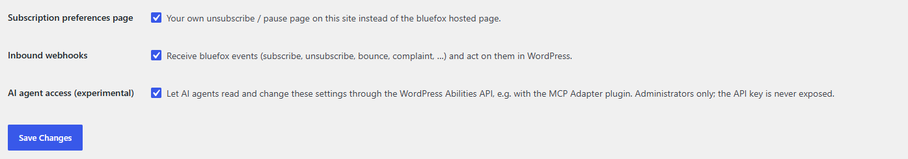

# AI agent access

Switch: **AI agent access (experimental)** (off by default, needs WordPress 6.9 or newer). Settings: [General tab](../settings/general.md).



Lets an AI agent read and change the plugin's settings in plain language – "show the popup after 15 seconds", "switch on the checkout opt-in", "which list do new subscribers go to?". The plugin registers its settings as **abilities** with the WordPress Abilities API, which is part of WordPress from version 6.9. An MCP client such as Claude reaches them through the **MCP Adapter** plugin.

!!! warning "Experimental"
    This feature is new and off by default. An agent with access can change live settings of your store – review what it did, and try it on a staging site first. On WordPress older than 6.9 the switch is greyed out (*Requires WordPress 6.9 or later*).

## Abilities

All abilities are in the **bluefox.email** category.

| Ability | Input | What it does |
|---|---|---|
| `cfbe/get-settings` | `area` (optional) | Returns the settings, grouped by area, and the on/off state of every feature module. Without `area` it returns all areas |
| `cfbe/update-settings` | `area`, `values` | Changes some keys of one area. Keys you don't send keep their value. Returns the saved settings, the `changed` keys and the `adjusted` keys whose saved value differs from what was sent |
| `cfbe/set-modules` | `modules` (module → `true` / `false`) | Switches feature modules on or off. A module whose required plugin is not active stays off |
| `cfbe/list-bluefox-lists` | – | Returns the subscriber lists of the connected bluefox project: `id`, `name`, `doi` (double opt-in on). Also refreshes the list cache used to validate list IDs |
| `cfbe/list-bluefox-emails` | – | Returns the `transactional` and `triggered` emails of the project (`id`, `name`), for the coupon email and order / abandoned cart rules |
| `cfbe/list-email-templates` | – | The ready-made emails of the [Email templates](email-templates.md) tab whose feature is on: what / why / when, allowed `types`, texts, whether created, where used, `design_outdated`. Also the design source and the project's sender identities |
| `cfbe/create-email-template` | `template`, optional `texts`, `type`, `list_id`, `sender_id`, `assign` | **Create in bluefox**: creates the email in the project and wires it up (coupon email, rule, double opt-in email). Triggered (marketing) emails need `list_id` |
| `cfbe/update-email-template` | `template`, optional `texts`, `force` | **Update in bluefox**: new texts and the current design. Refuses with `cfbe_template_changed` if the email was edited in bluefox – `force: true` replaces those edits |
| `cfbe/send-test-email` | `template` | **Send me a test**: sample data, always to the signed-in admin's own address |
| `cfbe/set-email-design` | `design` (`woocommerce` / `form`) | Design source of the templates. Returns the created emails whose design is now `outdated` |

**Areas** are the option groups of the settings tabs: `api`, `form`, `popup`, `checkout`, `coupon`, `emails`, plus one per enabled module (`sync`, `mailer`, `woo_events`, `integrations`, `webhooks`). The keys are listed in the [Settings reference](../settings/index.md).

**Module slugs**: `forms`, `checkout`, `coupon`, `sync`, `mailer`, `order_emails`, `abandoned_cart`, `integration_cf7`, `integration_wpforms`, `integration_fluentforms`, `integration_gravityforms`, `integration_elementor`, `preferences`, `webhooks`, `abilities`.

## Safety

- **Administrators only.** Every ability requires the plugin's admin capability (`manage_options`, filterable with `cfbe_capability`).
- **Secrets stay in wp-admin.** The API key and the webhook secret are never returned – `cfbe/get-settings` only reports `api_key_set` and `webhook_secret_set` – and `cfbe/update-settings` refuses to change them.
- **Same validation as the settings screens.** Values go through the same sanitizers. Invalid values fall back to a safe value and are reported under `adjusted`; unknown keys or areas return an error that lists the valid ones.
- A list value (for example `form.interests` or `woo_events.rules`) replaces the whole list, so the agent has to send the complete list.
- **Template emails write to bluefox.** `cfbe/create-email-template` and `cfbe/update-email-template` change your bluefox project like the buttons do. Changes made in bluefox are only replaced with an explicit `force`, emails switched to bluefox's visual editor never, and test emails only go to the signed-in admin.

## Connect an AI agent

1. Update WordPress to 6.9 or newer.
2. Tick **AI agent access (experimental)** on the **General** tab and save.
3. Install and activate the [MCP Adapter](https://github.com/WordPress/mcp-adapter) plugin. Its default MCP server lists the abilities and lets the client run them.
4. Create an **application password** for an administrator: **Users → Profile → Application Passwords**, enter a name such as *AI agent* and click **Add New Application Password**. Copy the password; it is shown only once.
5. Add the site to your MCP client. For clients that start local servers (for example Claude Desktop or Claude Code), the MCP Adapter documentation uses the `@automattic/mcp-wordpress-remote` proxy:

    ```json
    {
      "mcpServers": {
        "my-shop": {
          "command": "npx",
          "args": ["-y", "@automattic/mcp-wordpress-remote@latest"],
          "env": {
            "WP_API_URL": "https://your-site.example/wp-json/mcp/mcp-adapter-default-server",
            "WP_API_USERNAME": "your-admin-user",
            "WP_API_PASSWORD": "abcd efgh ijkl mnop qrst uvwx"
          }
        }
      }
    }
    ```

    Check the MCP Adapter documentation for the current server URL and client options.

6. Ask the agent to list the bluefox abilities to check the connection.

Revoke the application password under **Users → Profile** to cut the agent's access at any time, or untick the switch.

## Example prompts

- "Show me the current bluefox popup settings."
- "Show the newsletter popup after 15 seconds instead of on scroll, and never on mobile."
- "Change the signup form button to *Join now* and the heading to *Get 10% off your first order*."
- "Which bluefox lists do I have, and which of them have double opt-in on? Make the one called *Newsletter* the default list."
- "Switch on the checkout opt-in and the welcome coupon. Give new subscribers a 15% coupon valid for 14 days."
- "Add an order email rule: when an order is completed, send the bluefox email *Order shipped* as a transactional email."
- "Turn off the abandoned cart emails."
- "Create the review request email as a marketing email on my *Newsletter* list, then send me a test."
- "Use the WooCommerce email design for the templates and update the emails that are already in bluefox."

The agent will usually call `cfbe/get-settings` first to see the keys, then `cfbe/update-settings` or `cfbe/set-modules`, and report what was adjusted. For emails it starts with `cfbe/list-email-templates`.
