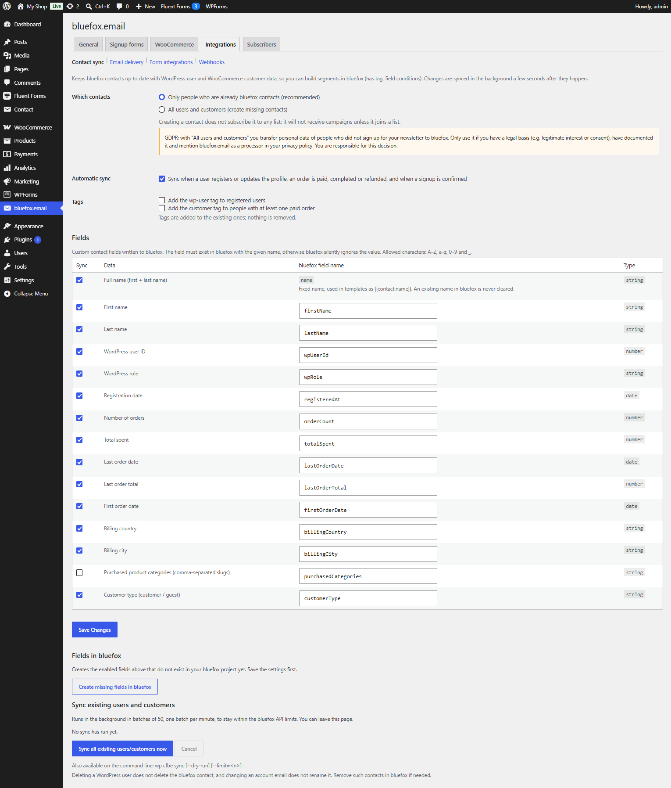

# Contact sync

Switch: **Contact sync**. Settings: [Contact sync tab](../settings/contact-sync.md).



Keeps bluefox contacts up to date with WordPress user and WooCommerce customer data, so you can build segments in bluefox with tags and field conditions – for example "customers with more than 3 orders" or "no order in the last 90 days".

## Which contacts

| Option | What happens |
|---|---|
| **Only people who are already bluefox contacts** (default, recommended) | existing contacts are updated; people who are not in bluefox are skipped |
| **All users and customers** | missing contacts are created too |

A created contact is not on any list, so it receives no campaigns until it joins one.

!!! warning "GDPR"
    With **All users and customers** you send personal data of people who never signed up for your newsletter to bluefox. Use it only with a documented legal basis, and list bluefox.email as a processor in your privacy policy.

A contact is only synced if the email belongs to a WordPress user or has at least one paid order.

## Fields

Each row of the **Fields** table is one bluefox contact field. Tick **Sync**, and change the **bluefox field name** if you like (A–Z, a–z, 0–9 and `_`).

| Data | Default name | Type | On by default |
|---|---|---|---|
| Full name (first + last name) | `name` (fixed) | string | yes |
| First name | `firstName` | string | yes |
| Last name | `lastName` | string | yes |
| WordPress user ID | `wpUserId` | number | yes |
| WordPress role | `wpRole` | string | yes |
| Registration date | `registeredAt` | date | yes |
| Number of orders | `orderCount` | number | yes |
| Total spent | `totalSpent` | number | yes |
| Last order date | `lastOrderDate` | date | yes |
| Last order total | `lastOrderTotal` | number | yes |
| First order date | `firstOrderDate` | date | yes |
| Billing country | `billingCountry` | string | yes |
| Billing city | `billingCity` | string | yes |
| Purchased product categories (comma-separated slugs) | `purchasedCategories` | string | no |
| Customer type (`customer` / `guest`) | `customerType` | string | yes |

The fields from *Number of orders* down need WooCommerce. For registered customers and guests alike, the order count and total spent are calculated from their paid orders (processing or completed), minus refunds. Dates are sent as `YYYY-MM-DD`.

The fields must exist in bluefox, otherwise bluefox silently ignores the values. Save the settings, then click **Create missing fields in bluefox**.

- `name` keeps its name, so `{{contact.name}}` works in templates. An existing name in bluefox is never cleared.
- Only changed values are sent.

## Tags

- **Add the `wp-user` tag to registered users.**
- **Add the `customer` tag to people with at least one paid order.**

Both are off by default. Tags are added to the existing ones; nothing is removed.

## Automatic sync

With **Automatic sync** on (default), a contact is synced in the background about 30 seconds after:

- a user registers or updates their profile, or a customer saves an address;
- an order becomes `processing`, `completed` or `refunded`;
- a signup is confirmed (`cfbe_signup_confirmed`).

Several changes to the same person within a few seconds are combined into one sync.

## Backfill

To sync everyone who is already on the site, click **Sync all existing users/customers now**.

- It runs in the background in batches of 50, one batch per minute, with a short pause between contacts, to stay within the bluefox API limits. You can leave the page.
- Registered users come first, then guest customers (billing emails of paid guest orders).
- The progress line shows the counts per result (created, updated, unchanged, not a contact, …). **Cancel** stops the run.

=== "wp-admin"

    **Contact sync → Sync all existing users/customers now**.

=== "WP-CLI"

    ```bash
    # Preview the first 10 contacts without writing to bluefox
    wp cfbe sync --dry-run --limit=10

    # Sync everyone in the foreground
    wp cfbe sync
    ```

    See [WP-CLI](../developers/wp-cli.md).

## Limits

- Deleting a WordPress user does not delete the bluefox contact, and changing an account email does not rename it. Clean these up in bluefox if needed.
- Developers can add or change values with the `cfbe_sync_contact_data` filter and slow the backfill down with `cfbe_sync_contact_pause_ms` – see [Hooks](../developers/hooks.md).
