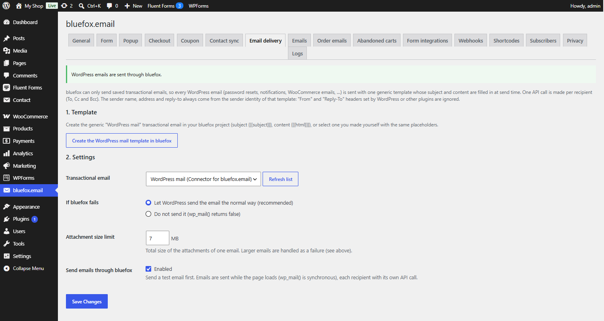

# Email delivery

Switch: **Send WordPress emails via bluefox**. Settings: [Email delivery tab](../settings/email-delivery.md).

Routes `wp_mail()` – password resets, admin notifications, WooCommerce emails, form plugin notifications – through the bluefox transactional API instead of your server's mail function or an SMTP plugin.

## How it works

bluefox can only send saved transactional emails. So the plugin uses one generic template whose subject and content are filled in at send time:

- subject `{{{subject}}}`;
- content `{{{html}}}`;
- preview text `{{previewText}}` (the first 100 characters of the text).

HTML emails are passed through as they are. Plain-text emails are escaped, links are made clickable and paragraphs are added.

- **One API call per recipient.** To, Cc and Bcc each get their own copy.
- **The sender comes from bluefox.** The sender name, address and reply-to are those of the template's sender identity. `From` and `Reply-To` headers set by WordPress or other plugins are ignored.
- **Attachments** are sent along, up to the **Attachment size limit** (default 7 MB, at most 40 MB per email). Unreadable files are skipped.
- **Multipart messages** (a hand-built MIME body) are left to WordPress.
- Sending happens while the page loads, like `wp_mail()` always does.

## Set it up

1. **Template** – click **Create the WordPress mail template in bluefox**, choose a sender identity and click **Create template**. This creates *WordPress mail (Connector for bluefox.email)*. You can also select your own transactional email that uses the same placeholders.
2. **Settings** – choose it as **Transactional email** and pick what happens **If bluefox fails**.
3. **Test** – enter an address and click **Send test email**.
4. Tick **Send emails through bluefox → Enabled** and save.

The notice at the top of the tab shows the current state: not live yet, enabled but no template selected, or *WordPress emails are sent through bluefox*.

## If bluefox fails

| Option | Result |
|---|---|
| **Let WordPress send the email the normal way** (default, recommended) | the email goes out through the default mailer (or your SMTP plugin). If some recipients already got it, only the failed ones are retried |
| **Do not send it** | `wp_mail()` returns `false` and `wp_mail_failed` fires |

The core actions `wp_mail_succeeded` and `wp_mail_failed` fire as usual, so mail logging plugins keep working. The plugin also fires `cfbe_mailer_failed` before falling back – see [Hooks](../developers/hooks.md).

## Recent deliveries

The tab lists the last 50 emails with time, recipient, subject (shortened) and result: *Sent*, *Test sent*, *Failed* or *Failed, sent by WordPress*. Email addresses in error notes are masked.

!!! warning "Sending limits"
    Every WordPress email counts against your bluefox sending limit, and a sandbox project only delivers a few emails a day. Verify your domain and get production access before you enable this on a live site.
