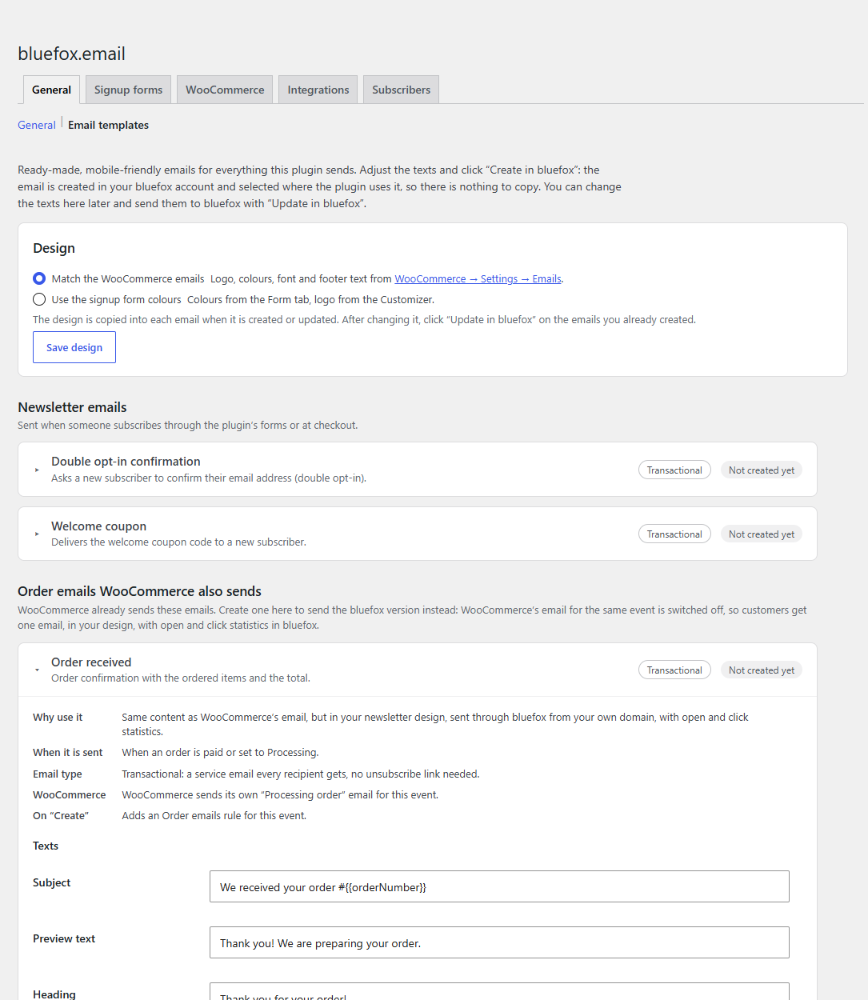
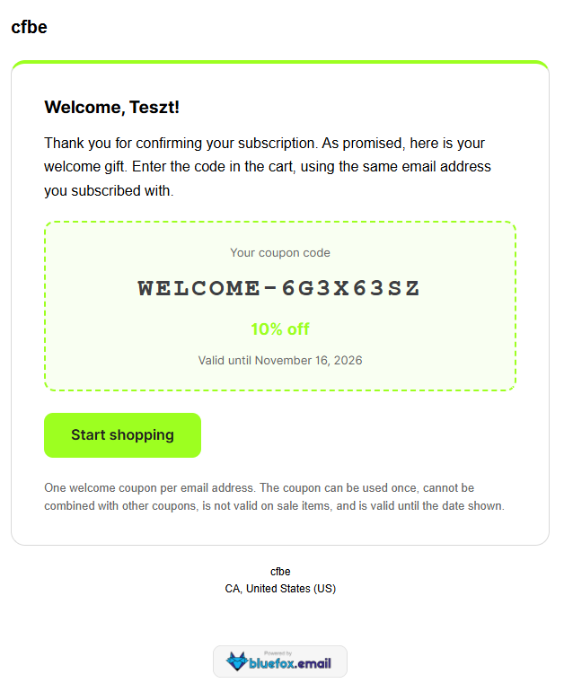
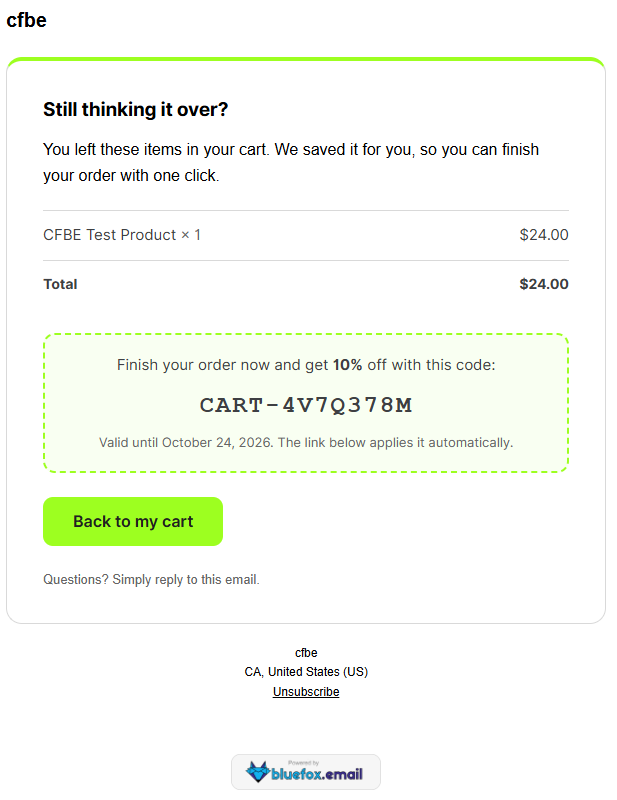
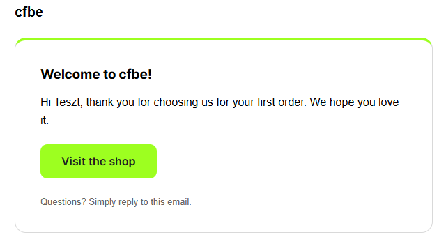
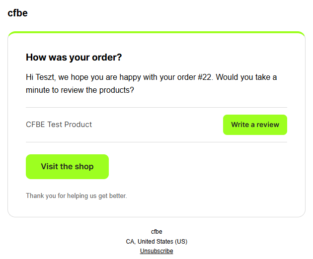

# Email templates

Tab: **General → Email templates** (`tab=email_templates`). Needs a bluefox connection.

The plugin never writes emails itself: it tells bluefox *which* email to send and fills in the data (coupon code, order items, cart link …). Normally you would build each email in bluefox and copy its ID into the plugin. The **Email templates** tab does that for you: ready-made, mobile-friendly emails for everything the plugin sends, created in bluefox with one click and selected where the plugin uses them.

Every card says **what** the email is, **why** you would use it, **when** it is sent, its **email type** and – once created – **where it is used** (*In use*, *Created, not in use*, with a link to that tab).

## The templates

The cards are grouped:

- **Newsletter emails** – double opt-in confirmation and welcome coupon.
- **Extra emails WooCommerce does not send** – first order thank-you, review request, abandoned cart reminder. WooCommerce keeps sending its own order emails; these come on top.

| Template | Type | Shown when | Wired up on **Create** |
|---|---|---|---|
| Double opt-in confirmation | transactional | Signup forms on | Double opt-in is switched on for the chosen list with this email, and your thank-you page becomes the list's redirect link. |
| Welcome coupon | transactional | Welcome coupon on | Selected as **Coupon email ID** on the Coupon tab. |
| First order thank-you | triggered or transactional (you choose) | Order emails on | Rule *First paid order of a customer*. |
| Review request | triggered or transactional (you choose) | Order emails on | Rule *Review request*, 7 days after completion. The email lists the ordered products, each with a **Write a review** button that opens the product page on its Reviews tab (no prices). |
| Abandoned cart reminder | triggered | Abandoned cart emails on | Rule *Abandoned cart*, with the item list, restore button and – when switched on – the recovery coupon. |

Rules: when a rule for the event already exists **without** an email, the new email is filled into it and the rule is switched on. When the existing rule already has an email, nothing is changed – select the new email there if you want it.

**Triggered** emails are marketing emails: they belong to a subscriber list, only its active subscribers receive them, and they carry an unsubscribe link. Choose the list when you create them.

For the **first order thank-you** and the **review request** you choose the **Email type** before creating:

- **Marketing (triggered)** – the default. Only active subscribers of the chosen list get it, with an unsubscribe link. The safe choice when the email also promotes the shop.
- **Transactional** – every customer gets it, subscribed or not, without an unsubscribe link. Keep the content about the order itself, without offers.

The rule on the Order emails tab gets the same type. The abandoned cart reminder is always a marketing email.

## Examples

Real emails created with these templates and sent from a test shop (WooCommerce email design, so the green comes from the shop's WooCommerce base colour):

## Texts

Each card has six texts, prefilled in the site language: **Subject**, **Preview text**, **Heading**, **Text**, **Button label** and **Small print**. The variables listed on the card work in every text, e.g. `Your order #{{orderNumber}}` or `Hi {{DEFAULT billing.firstName "there"}}`. The layout, the data blocks (items, coupon box, note), the button link and the unsubscribe link are added by the plugin.

## Design

Choose the design at the top of the tab:

| Design | Uses |
|---|---|
| **Match the WooCommerce emails** (default with WooCommerce) | **WooCommerce → Settings → Emails**: header image (width and alignment), base colour (button, accent line, coupon frame), background, body background, text and footer text colours, font family and footer text (`{site_title}`, `{store_address}` … filled in). The bluefox emails look like the shop's own emails. |
| **Use the signup form colours** | The **Form** tab colours (button = primary colour, accent line and coupon frame = accent colour) and the site logo (Customizer logo, else the site icon, else the site name). |

The design is copied into the email when it is **created** or **updated**. If you change it later (or change WooCommerce's email settings), the cards of emails already in bluefox show *The design changed since this email was last sent to bluefox* – click **Update in bluefox** to apply it. Developers can change the design with the `cfbe_email_design` filter.

## Buttons

| Button | What it does |
|---|---|
| **Create in bluefox** | Creates the email (HTML type) with the chosen **Sender** (empty = the project's default sender) and, for triggered emails, the **Subscriber list**. With **Use it** ticked (default) it is wired up as in the table above. |
| **Update in bluefox** | Sends the edited texts to the existing email. |
| **Preview** | Opens the email in a new tab, filled with sample data (name, order, products, coupon) and the texts as they are on the card – also before you save or create it. Nothing is sent. |
| **Send me a test** | bluefox sends the email to your own admin address. bluefox test sends show the layout only: the variables (name, order number, products …) stay empty in tests and are filled in real sends. Use **Preview** to check the content. |

### Editing in two places

You can keep editing the texts here, or open the email in bluefox and change it there – nothing is lost silently:

- **Update in bluefox** first checks when the email was last changed in bluefox. If someone changed it there after the plugin's last write, you are warned and can choose **Replace the version in bluefox** (or leave it).
- An email switched to bluefox's visual (drag-and-drop) editor is never overwritten: edit it in bluefox.
- An email deleted in bluefox is forgotten; the card offers **Create in bluefox** again.

What was created is stored in the option `cfbe_email_templates` (email ID, type, texts, list, bluefox's `updatedAt` after the last write and a fingerprint of the design). The design choice is in `cfbe_email_design` (`woocommerce` or `form`).

!!! tip "Already have your own emails?"
    You don't need the templates. Select your own bluefox emails on the Coupon, Order emails and Abandoned carts tabs as before.
