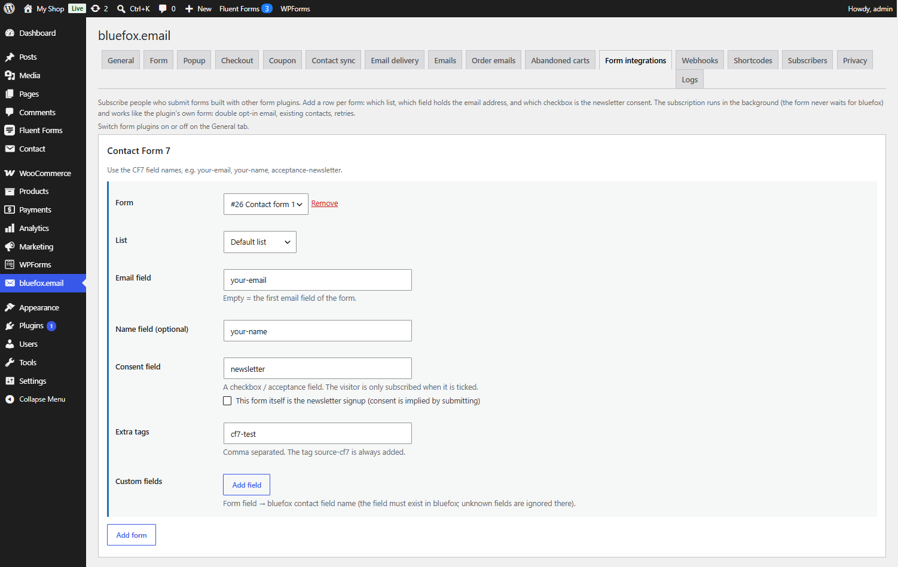

# Form plugin integrations

Switches: **Contact Form 7**, **WPForms**, **Fluent Forms**, **Gravity Forms**, **Elementor Pro Forms** – one per form plugin, each needs that plugin to be active. Settings: [Form integrations tab](../settings/form-integrations.md).

Subscribe people who submit forms built with another form plugin – a contact form with a "Send me the newsletter" checkbox, or a dedicated signup form.

## How it works

For each form you set: which list, which field holds the email address, which checkbox is the newsletter consent, and optionally the name, extra tags and custom fields.

- The subscription runs **in the background**: the form never waits for bluefox and bluefox errors never break the form.
- From there it works like the plugin's own form: bluefox sends the double opt-in email, existing contacts are handled the same way, failed calls are retried. Confirmed signups can get the [welcome coupon](welcome-coupon.md).
- The tag `source-<plugin>` is always added: `source-cf7`, `source-wpforms`, `source-fluentforms`, `source-gravityforms` or `source-elementor`. There is no interests field.
- The consent record stores the form plugin, form ID and title, and the label of the consent field.

## Consent

Nobody is subscribed unless one of these is true:

- **Consent field** – a checkbox or acceptance field that the visitor ticked. Empty, `0`, `false`, `off` and `no` count as not ticked.
- **This form itself is the newsletter signup** – consent is implied by submitting. Use it only when the form clearly says that submitting it subscribes to the newsletter (GDPR: consent must be informed and unambiguous).

A form with neither shows a warning and subscribes nobody.

## Fields per form

| Field | Notes |
|---|---|
| **Form** | dropdown of your forms (or a form ID box) |
| **List** | empty = the default list from the General tab |
| **Email field** | empty = the first email field of the form |
| **Name field (optional)** | stored as the contact's `name` |
| **Consent field** | see above |
| **Extra tags** | comma separated |
| **Custom fields** | form field → bluefox contact field name, up to 30. The field must exist in bluefox. `email`, `tags` and `status` are not allowed |

You can add several rows for the same form, for example to subscribe to two lists. Up to 50 forms per plugin.

## Field names per plugin

=== "Contact Form 7"

    Use the CF7 field names, e.g. `your-email`, `your-name`, `acceptance-newsletter`.

    The visitor is subscribed after CF7 has sent its mail successfully (`wpcf7_mail_sent`). An `[acceptance]` tag works well as the consent field; its text is stored as the consent text.

=== "WPForms"

    Use the WPForms field IDs shown in the form builder, e.g. `1`, `2`. Parts of a Name field are `1.first` and `1.last`.

    Runs on `wpforms_process_complete`, which fires only for successful entries. Works with WPForms Lite.

=== "Fluent Forms"

    Use the input names (**Advanced Options → Name Attribute**), e.g. `email`, `names.first_name`, `terms-n-condition`.

    Runs when the submission is saved (`fluentform/submission_inserted`).

=== "Gravity Forms"

    Use the field IDs, e.g. `3`. A single input of a composite field is `1.3` (first name) or `1.6` (last name). A Name field ID (`1`) gives the full name, a Consent field ID gives its checkbox.

    Runs on `gform_after_submission`. Entries marked as spam are skipped.

=== "Elementor Pro"

    Elementor forms are not set up on the plugin's tab. In each **Form** widget:

    1. Under **Actions After Submit** add **bluefox.email**.
    2. Open the new **bluefox.email** section and fill in **List**, **Email field ID** (empty = the first email field), **Name field ID (optional)**, **Consent field ID** or **This form itself is the newsletter signup**, **Extra tags** and **Custom fields** (one per line: `form field ID=bluefox contact field name`).

    Use the fields' custom IDs (**Advanced → ID**), e.g. `email`, `name`, `newsletter`.

## For developers

The `cfbe_integration_signup` filter receives the signup data before it is queued; return a non-array to skip it. See [Hooks](../developers/hooks.md).
