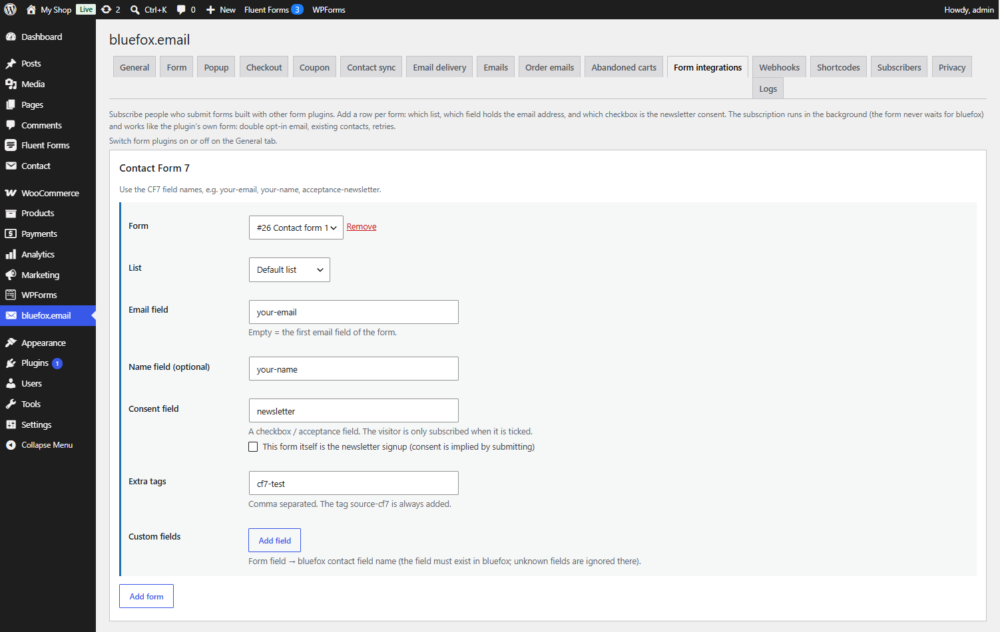

# Form plugin integrations

Switches: **Contact Form 7**, **WPForms**, **Fluent Forms**, **Gravity Forms**, **Elementor Pro Forms** – one per form plugin, each needs that plugin to be active. Settings: [Form integrations tab](../settings/form-integrations.md).

Subscribe people who submit forms built with another form plugin – a contact form with a "Send me the newsletter" checkbox, or a dedicated signup form.

## How it works

For each form you set: which list, which field holds the email address, which checkbox is the newsletter consent, and optionally the name, extra tags and custom fields. Fields with a recognisable name – first name, last name, phone, city, … – are [matched automatically](#match-fields-by-name).

- The subscription runs **in the background**: the form never waits for bluefox and bluefox errors never break the form.
- From there it works like the plugin's own form: bluefox sends the double opt-in email, existing contacts are handled the same way, failed calls are retried. Confirmed signups can get the [welcome coupon](welcome-coupon.md).
- The tag `source-<plugin>` is always added: `source-cf7`, `source-wpforms`, `source-fluentforms`, `source-gravityforms` or `source-elementor`. There is no interests field.
- The consent record stores the form plugin, form ID and title, and the label of the consent field.

## Consent

Nobody is subscribed unless one of these is true:

- **Consent field** – a checkbox or acceptance field that the visitor ticked. Empty, `0`, `false`, `off` and `no` count as not ticked.
- **This form itself is the newsletter signup** – consent is implied by submitting. Use it only when the form clearly says that submitting it subscribes to the newsletter (GDPR: consent must be informed and unambiguous).

A form with neither shows a warning and subscribes nobody.

## Fields per form

| Field | Notes |
|---|---|
| **Form** | dropdown of your forms (or a form ID box) |
| **List** | empty = the default list from the General tab |
| **Email field** | empty = the first email field of the form |
| **Name field (optional)** | stored as the contact's `name`. A name group (Fluent Forms `names`) also fills First name / Last name. Empty = found by [matching](#match-fields-by-name) |
| **Consent field** | see above |
| **Extra tags** | comma separated |
| **Match fields by name** | on – see [below](#match-fields-by-name) *(since 1.1.0)* |
| **Custom fields** | form field → bluefox contact field name, up to 30. The field must exist in bluefox. `email`, `tags` and `status` are not allowed. A field set here wins over a match by name |

You can add several rows for the same form, for example to subscribe to two lists. Up to 50 forms per plugin.

## Match fields by name

*Since 1.1.0.* With **Match fields by name** on (the default, also for forms set up earlier), a form field whose name matches a field of the [Contact sync](contact-sync.md#fields) table is sent to bluefox under that field's bluefox name – no mapping needed.

| Contact sync field | Form field names that match |
|---|---|
| Name (`name`) | `name`, `full_name`, `your-name` |
| First name (`firstName`) | `first_name`, `firstName`, `fname`, `given_name` – and Fluent Forms `names.first_name` |
| Last name (`lastName`) | `last_name`, `lastName`, `lname`, `surname`, `family_name` – and `names.last_name` |
| Billing phone (`billingPhone`) | `phone`, `phone_number`, `tel`, `telephone`, `billing_phone` |
| Billing company | `company`, `company_name` |
| Billing address | `address`, `street_address`, `address_line_1` |
| Billing city | `city` |
| Billing postcode | `postcode`, `zip`, `zip_code`, `postal_code` |
| Billing state | `state` |
| Billing country | `country` |

- Case, `_`, `-` and spaces don't matter: `First_Name`, `first-name` and `firstName` are the same. The bluefox name you gave a field on the Contact sync tab matches too (e.g. `telefon`).
- Only fields **switched on** on the Contact sync tab are matched. Name, First name, Last name, City and Country are on by default; the billing phone, company, address, postcode and state are off – switch them on to take them from forms (they are then synced from WooCommerce too). The tab lists the fields that are matched right now.
- Store data – order count, total spent, role, dates, customer type – is never taken from a form.
- The email and consent fields are never matched. A field mapped under **Custom fields** wins.
- Without a **Name field**, the name is built from the matched name, or from first name + last name. A form that only asks for the first name sends it as First name and as the name.
- The log shows which fields were matched (*Form integration matched fields by name*, names only, no values).
- Matching uses the field names, not the labels. WPForms and Gravity Forms use numbers as field IDs, so map their fields under **Custom fields** instead (e.g. `1.first` → `firstName`).

### Setting it up

1. On the **Contact sync** tab, switch on the fields you want to collect from forms (e.g. **Billing phone**) and click **Create missing fields in bluefox** – bluefox drops values of fields that don't exist in the project. The **bluefox setup** on the General tab creates First name and Last name too.
2. Give the form fields matching names – in Fluent Forms **Advanced Options → Name Attribute**, e.g. `first_name`, `phone`. Fluent's **Name** field (`names`) works as it is.
3. Leave **Match fields by name** on for the form on the Form integrations tab. Submit a test entry and check the contact in bluefox.

!!! note "Existing contacts"
    For a new signup the values are saved with the contact right away. If the address is already on the list but not confirmed yet, the name and fields are added after the confirmation; an already active contact is not changed from a third-party form (nobody proved they own the address).

## Field names per plugin

=== "Contact Form 7"

    Use the CF7 field names, e.g. `your-email`, `your-name`, `acceptance-newsletter`.

    The visitor is subscribed after CF7 has sent its mail successfully (`wpcf7_mail_sent`). An `[acceptance]` tag works well as the consent field; its text is stored as the consent text.

=== "WPForms"

    Use the WPForms field IDs shown in the form builder, e.g. `1`, `2`. Parts of a Name field are `1.first` and `1.last`.

    Runs on `wpforms_process_complete`, which fires only for successful entries. Works with WPForms Lite.

=== "Fluent Forms"

    Use the input names (**Advanced Options → Name Attribute**), e.g. `email`, `names.first_name`, `terms-n-condition`.

    Runs when the submission is saved (`fluentform/submission_inserted`).

=== "Gravity Forms"

    Use the field IDs, e.g. `3`. A single input of a composite field is `1.3` (first name) or `1.6` (last name). A Name field ID (`1`) gives the full name, a Consent field ID gives its checkbox.

    Runs on `gform_after_submission`. Entries marked as spam are skipped.

=== "Elementor Pro"

    Elementor forms are not set up on the plugin's tab. In each **Form** widget:

    1. Under **Actions After Submit** add **bluefox.email**.
    2. Open the new **bluefox.email** section and fill in **List**, **Email field ID** (empty = the first email field), **Name field ID (optional)**, **Consent field ID** or **This form itself is the newsletter signup**, **Extra tags** **Match fields by name** (on by default) and **Custom fields** (one per line: `form field ID=bluefox contact field name`).

    Use the fields' custom IDs (**Advanced → ID**), e.g. `email`, `name`, `newsletter`.

## For developers

The `cfbe_integration_signup` filter receives the signup data before it is queued; return a non-array to skip it. See [Hooks](../developers/hooks.md).
