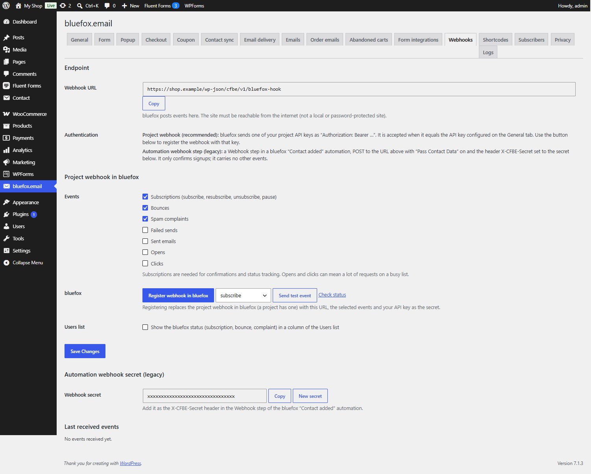

# Inbound webhooks

Switch: **Inbound webhooks** (on by default). Settings: [Webhooks tab](../settings/webhooks.md).



bluefox can post events to your site: subscription changes, bounces, spam complaints, opens, clicks, sent and failed emails. The plugin stores them on the matching WordPress user and passes them on to developer hooks.

Registering the webhook in bluefox is described in [Webhook](../getting-started/webhook.md).

!!! note "Confirmations work without this switch"
    The endpoint `/wp-json/cfbe/v1/bluefox-hook` is always registered. Signup confirmations (and the welcome coupon) are handled even when **Inbound webhooks** is off. The switch adds the Webhooks tab, the event processing below and the Users column.

## Events

| Event | Default | bluefox event types |
|---|---|---|
| Subscriptions | on | `subscribe`, `resubscribe`, `unsubscribe`, `pause-subscription` |
| Bounces | on | `bounce` |
| Spam complaints | on | `complaint` |
| Opens | off | `open` |
| Clicks | off | `click` |
| Sent emails | off | `sent` |
| Failed sends | off | `failed` |

Subscriptions are needed for confirmations and status tracking. Opens and clicks can mean a lot of requests on a busy list.

## What is stored

Events are processed in a background job right after they arrive. If the email belongs to a WordPress user:

| Event | User meta |
|---|---|
| Subscription | `cfbe_list_status` – list ID → `active`, `paused`, `unsubscribed` or `unverified` |
| Bounce | `cfbe_bounced` – time and bounce type |
| Spam complaint | `cfbe_complained` – time |

Subscription events for a signup made with the plugin also update the status on the **Subscribers** tab, so an unsubscribe in bluefox is visible in WordPress.

The **Last received events** table on the tab shows the last 20 events with time, type and masked email.

### Users list column

Tick **Users list → Show the bluefox status … in a column of the Users list** to add a **bluefox** column to **Users**. It shows the status per list, and *Bounced* or *Spam complaint* when that happened.

## Test

- **Send test event** – choose a **Test event type** and let bluefox post a test event to your site.
- **Check status** – reads the webhook from bluefox and warns if it uses another API key than the one configured here (then the site would reject the events: register it again).

## Security

- bluefox sends one of the project's API keys as `Authorization: Bearer …`; the plugin compares it with your API key in constant time. If the server strips the header, the plugin also reads `REDIRECT_HTTP_AUTHORIZATION` and `apache_request_headers()`. See [Troubleshooting](../help/troubleshooting.md).
- Requests are rate limited (60 per IP per minute) and limited to 64 KB.
- Payloads longer than about 7000 characters are cut to the fields the plugin uses before they are queued. The background hooks then get a payload with `truncated: true`; `cfbe_webhook_received` (at request time) still gets the full body.
- Webhook data is never trusted for confirmations: the plugin reads the subscriber's status from the bluefox API again before it acts.

## For developers

| Hook | Parameters | Fires |
|---|---|---|
| `cfbe_webhook_received` | `string $type, array $payload` | for every authenticated event with a type, in the request, while this feature is on |
| `cfbe_webhook_event` | `string $type, array $payload` | in the background job, for every event |
| `cfbe_webhook_{type}` | `array $payload` | in the background job, e.g. `cfbe_webhook_bounce`, `cfbe_webhook_unsubscribe` |

```php
add_action( 'cfbe_webhook_complaint', function ( array $payload ) {
    $email = $payload['emailData']['to'] ?? '';
    // e.g. flag the customer in your CRM.
} );
```

The REST endpoint is described in [REST API](../developers/rest-api.md), all hooks in [Hooks](../developers/hooks.md).
