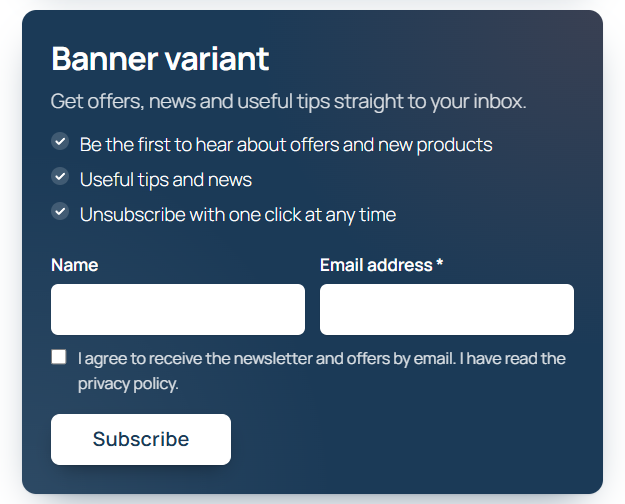

# Signup forms

Switch: **Signup forms** (on by default). Settings: [Form tab](../settings/form.md).

The form has an optional **Name** field, the required **Email address**, an optional [interests](interests-tags.md) field, a required **consent checkbox** and a submit button. Texts, colours and corner radius are set on the Form tab; the tab shows a live preview.

| Card | Banner |
|---|---|
|  |  |

Three styles are available: **Card** (light background, subtle border), **Banner** (primary-colour background, light button) and **Plain** (no decoration). The **Inline** layout puts the fields in one row on wide screens.

## Add a form to a page

=== "Block"

    In the block editor add the **bluefox.email signup form** block. The sidebar has three panels:

    - **Subscription** – the bluefox list (empty = default list), extra tags and a placement name.
    - **Content** – heading, intro text and button label (empty = the Form tab text).
    - **Layout and fields** – style, and toggles to hide the Name and Interests fields.

    The block supports wide and full alignment and renders on the server, so the editor preview matches the site.

=== "Shortcode"

    Put `[cfbe_form]` in a Shortcode block, a classic editor, a widget or your page builder's shortcode element. `[cfbe_newsletter]` is an alias.

    ```text
    [cfbe_form variant="banner" layout="inline" heading_tag="h3" place="footer"]
    [cfbe_form list="LIST_ID" tags="webinar,spring-campaign" place="webinar"]
    ```

    All attributes are listed in [Shortcodes and block](../developers/shortcodes-block.md).

=== "Promo bar"

    `[cfbe_promo]` shows a compact box or bar with a button. The button opens the full form in a dialog, or scrolls to a form on the page.

    ```text
    [cfbe_promo style="bar" place="top"]
    [cfbe_promo style="bar" place="top" action="scroll"]
    [cfbe_promo style="dark" place="product"]
    ```

    

    With `action="scroll"` the button scrolls to the last `[cfbe_form]` on the page (or the `target="#id"` element) and focuses the email field; if there is no form, it opens the dialog.

=== "Popup"

    See [Popup](popup.md).

The **Shortcodes** tab in wp-admin has ready-to-copy examples (top bar, footer band, card in the content, list-specific form, thank-you and preferences pages) and the full attribute reference.

## List and tags per form

A form can subscribe to another list than the default and add extra tags. The list, the tags and the placement name are **signed** into the form (HMAC with the site's salt), so visitors cannot change them in the browser. Unsigned values are ignored.

A signed list is only used when it is one of your project's lists that an admin has loaded with **Load lists** on the General tab, or a list chosen in the settings (default, popup, checkout or coupon list). Any other list falls back to the default list.

!!! tip "New bluefox list?"
    After you create a list in bluefox and use it in a shortcode or block, click **Load lists** on the General tab once. Until then, signups from that form go to the default list.

## `{discount}` placeholder

In the heading, intro, benefits, button, offer line, badge and promo texts, `{discount}` is replaced with the welcome coupon value from the Coupon tab, e.g. `10%` or `€20`.

## After submit

The visitor sees one of the messages from the Form tab:

| Situation | Message |
|---|---|
| New signup, confirmation email re-sent, queued for retry, already subscribed, or an address bluefox suppressed (bounced, complained) | Successful signup |
| Already an active or paused subscriber, and **Show the "Already subscribed" message** is on | Already subscribed |
| bluefox is not configured, or another error | Error |

By default the form gives the same answer whether or not an address is on your list, so nobody can use it to find out who is subscribed. A suppressed address shows as `failed` on the Subscribers tab.

Existing contacts are never changed by an unconfirmed request:

| bluefox status | What happens |
|---|---|
| `active` | Nothing changes: no name or tag update, no coupon. |
| `unverified` | The confirmation email is re-sent (at most once a day per mailbox). Name and tags are applied after the person confirms. |
| `unsubscribed` | bluefox re-sends its confirmation email (at most once a day per mailbox). Name and tags are applied after the person confirms. |
| `paused` | Stays paused; nothing changes. |

The exception is a request made by the address owner: a logged-in customer ordering with their own account email, or the My Account opt-in. Then the contact is updated at once, and a paused contact is made active again.

A new signup for an address whose earlier signup expired or failed starts over: the row goes back to pending with the new data and consent.

## Spam protection without nonces

Public forms contain no nonces and nothing visitor-specific, so they work on cached pages. Instead:

- a hidden **honeypot** field;
- a **fill-time token** – when the form becomes visible, the script fetches a token signed by the site from `/wp-json/cfbe/v1/form-token` (never cached). Submissions without a valid token, or with one younger than 3 seconds or older than 2 hours, are dropped (the bot still sees a success message). The script waits out the rest of the 3 seconds for fast visitors, so this works on cached pages too;
- **rate limits** – 5 submissions per IP per 10 minutes (IPv6: per /64 range), 30 signups per minute for the whole site, and 3 signups per mailbox per hour from any source (forms, checkout, My Account, form plugins). *Mailbox* ignores `+tag` aliases and, for Gmail, dots;
- at most one confirmation email re-sent per mailbox per day;
- a 4 KB request size limit.

## Accessibility

Labels on every field, error messages linked with `aria-describedby`, a polite live region for the result, focus moved to the result, and in the popup a focus trap, `role="dialog"`, `aria-modal` and Esc to close. Animations respect `prefers-reduced-motion`.

## Loading of assets

By default the CSS and JavaScript (`cfbe-form.css`, `cfbe-form.js`) load only on pages with a form. Turn on **Form → Loading → Load CSS/JS on every page** to avoid a flash of unstyled content when a form is added by a page builder late in the page. If a caching plugin delays JavaScript (for example WP Rocket's *Delay JavaScript execution*), exclude `cfbe-form.js` and `cfbe-popup.js`.
