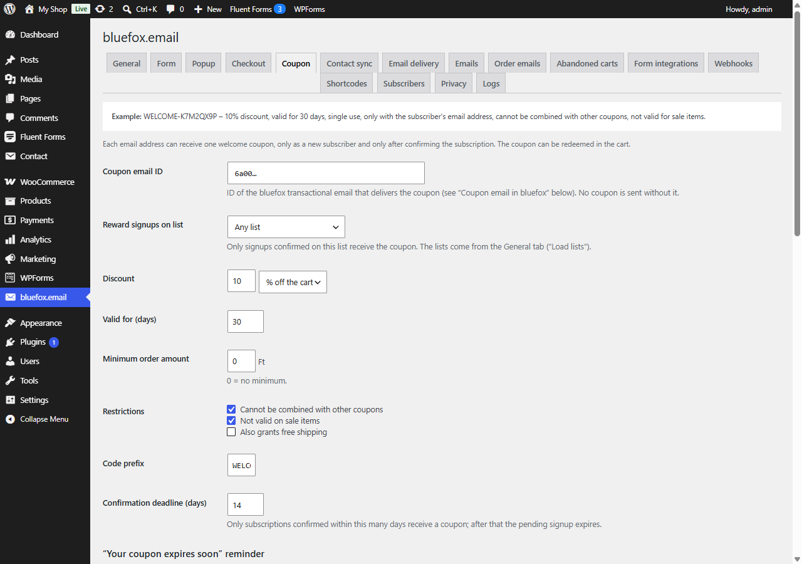

# Welcome coupon

Switch: **Welcome coupon** (needs WooCommerce). Settings: [Coupon tab](../settings/coupon.md).

New subscribers get a single-use WooCommerce coupon by email **after** they confirm the double opt-in email.

## Rules

- **One coupon per email address.** The lookup is by the normalised email; a second signup never creates a second coupon.
- **One coupon per mailbox** (Coupon tab, **Email aliases**, on by default). Aliases such as `name+shop@example.com` and Gmail addresses written with dots (`j.ane@gmail.com`, also `googlemail.com`) count as the same mailbox. An alias of an address that already got a coupon gets none: its row becomes *Already subscribed (no coupon)* with a note.
- **Only new subscribers who signed up through this plugin.** People who were already active on the list, came back from *paused*, or reached the list another way (bluefox import, bluefox's own form) get no coupon.
- **Only after confirmation.** The status is read from the bluefox API before the coupon is created. Signups not confirmed within the **Confirmation deadline** (Emails tab, default 14 days) expire without a coupon.
- **Only on the chosen list** if **Reward signups on list** is set; otherwise confirmed signups on any list qualify.

Tell visitors in your offer: one welcome coupon per email address, redeemable in the cart.

When a personal data erasure request is processed, unused welcome coupons of the address are deleted and used ones are anonymised. See [Privacy and GDPR](../help/privacy.md#export-and-erase-personal-data).

## The coupon

| Property | Value |
|---|---|
| Code | prefix + 8 random characters (no 0/O/1/I), e.g. `WELCOME-K7M2QX9P` |
| Discount | % off the cart or a fixed amount off the cart |
| Usage limit | 1, and 1 per user |
| Allowed emails | only the subscriber's email |
| Expiry | end of the day, *Valid for (days)* after creation |
| Options | minimum order amount, individual use, exclude sale items, free shipping |

The coupon description is *Newsletter welcome coupon – email*. Meta `_cfbe_welcome_email` and `_cfbe_source` link it to the signup.

## The coupon email

The coupon is sent with a **bluefox transactional email** that you design in bluefox:

1. In bluefox create a transactional email of type HTML (e.g. *Welcome coupon*), subject for example `Your {{discount}} welcome coupon`.
2. Paste the **Welcome coupon template** from the Coupon tab (also in `templates/emails/welcome-coupon.html`) and adjust it.
3. Copy the email ID into **Coupon email ID**. No coupon is sent without it.

Merge tags: `{{couponCode}}`, `{{discount}}`, `{{expiry}}`, `{{minSpend}}`, `{{terms}}`, `{{name}}`, `{{shopName}}`, `{{shopUrl}}` and contact fields such as `{{contact.name}}`. See [Email template data](../developers/template-data.md#welcome-coupon-email).

The coupon email is transactional (no unsubscribe link). Keep it about the coupon only.

If creating the coupon or sending the email fails, the job is retried every 10 minutes, up to 5 attempts. Admins can resend the coupon email (same code) from the **Subscribers** tab or with `wp cfbe resend-coupon <email>`.

## "Your coupon expires soon" reminder

With **Coupon data in bluefox** on (default), the plugin writes `couponCode`, `couponExpires` and `couponUsed` to the bluefox contact. `couponUsed` follows WooCommerce: it is set when an order with the coupon is placed and cleared when that order is cancelled.

Build the reminder in bluefox:

1. **Segments → new segment** "Coupon expires soon": `couponUsed = false` AND `couponExpires` within the next *N* days (the **Reminder before expiry** value, default 5).
2. **Automations → new automation**: *Enter segment "Coupon expires soon"* (once per contact) → *Send email*.
3. In the email use `{{contact.couponCode}}` and `{{contact.name}}`.

Click **Create bluefox fields** to create the `name`, `couponCode`, `couponExpires` and `couponUsed` fields.
