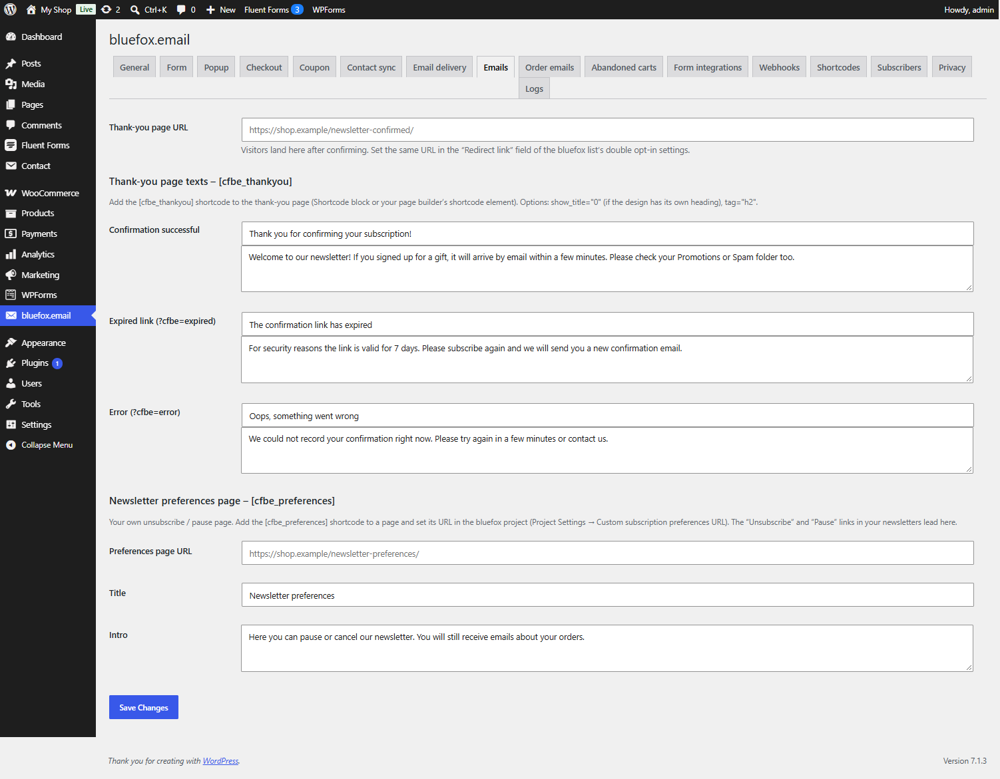

# Emails tab

Tab id: `emails` · Option: `cfbe_emails` · Needs: **Signup forms**.

The thank-you page and preferences page texts. See [Thank-you and preferences pages](../getting-started/pages.md) and [Preferences page](../features/preferences-page.md).

## Thank-you page

| Label | Option key | Default | What it does |
|---|---|---|---|
| Thank-you page URL | `cfbe_emails[thankyou_url]` | empty = `/newsletter-confirmed/` | Where visitors land after confirming. Set the same URL as the **Redirect link** of the bluefox list. The popup is never shown on this page. |
| Confirmation deadline (days) | `cfbe_emails[pending_expiry_days]` | `14` | 1–60. A signup not confirmed within this time expires: it no longer counts as pending and never receives a welcome coupon. |

### Thank-you page texts – [cfbe_thankyou]

Each state has a title and a text. An empty value falls back to the default. The texts allow basic HTML (`wp_kses_post`).

| Label | Option keys | Default title | Default text |
|---|---|---|---|
| Confirmation successful | `cfbe_emails[thankyou_confirmed_title]`, `[thankyou_confirmed_text]` | *Thank you for confirming your subscription!* | *Welcome to our newsletter! If you signed up for a gift, it will arrive by email within a few minutes. Please check your Promotions or Spam folder too.* |
| Expired link (?cfbe=expired) | `cfbe_emails[thankyou_expired_title]`, `[thankyou_expired_text]` | *The confirmation link has expired* | *For security reasons the link is valid for 7 days. Please subscribe again and we will send you a new confirmation email.* |
| Error (?cfbe=error) | `cfbe_emails[thankyou_error_title]`, `[thankyou_error_text]` | *Oops, something went wrong* | *We could not record your confirmation right now. Please try again in a few minutes or contact us.* |

## Newsletter preferences page – [cfbe_preferences]

| Label | Option key | Default | What it does |
|---|---|---|---|
| Preferences page URL | `cfbe_emails[preferences_url]` | empty = `/newsletter-preferences/` | The page with `[cfbe_preferences]`. Set the same URL as the bluefox project's **Custom subscription preferences URL**. |
| Title | `cfbe_emails[prefs_title]` | *Newsletter preferences* | Page heading. Empty = the default. |
| Intro | `cfbe_emails[prefs_intro]` | *Here you can pause or cancel our newsletter. You will still receive emails about your orders.* | Text under the heading. Basic HTML allowed. |

