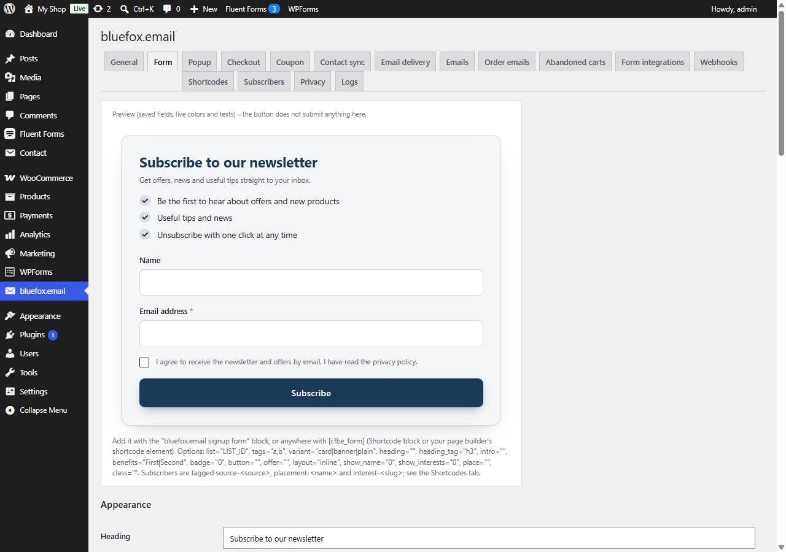

# Form tab

Tab id: `form` · Option: `cfbe_form` · Needs: **Signup forms**.

These settings are shared by the block, `[cfbe_form]`, `[cfbe_promo]` and the popup. Block and shortcode attributes override them for a single placement. The top of the tab shows a live preview (colours and texts update as you type; the button does not submit). See [Signup forms](../features/signup-forms.md).

## Appearance

| Label | Option key | Default | What it does |
|---|---|---|---|
| Heading | `cfbe_form[heading]` | *Subscribe to our newsletter* | Form heading. Empty = no heading. `{discount}` is replaced. |
| Button text | `cfbe_form[button]` | *Subscribe* | Submit button label. |
| Offer line (below the button) | `cfbe_form[offer]` | empty | Short line under the button, e.g. *{discount} off your first order*. Empty = hidden. |
| Intro text | `cfbe_form[intro]` | *Get offers, news and useful tips straight to your inbox.* | Paragraph under the heading. Empty = hidden. |
| Promo bar – [cfbe_promo] → Title | `cfbe_form[promo_heading]` | *Join our newsletter* | Heading of the promo box / bar. |
| Promo bar → Text | `cfbe_form[promo_text]` | *Offers, news and tips – straight to your inbox.* | Text of the promo box. |
| Promo bar → Button | `cfbe_form[promo_button]` | *Subscribe* | Promo button label. |
| Promo bar → The button | `cfbe_form[promo_action]` | `dialog` (*opens the form in a popup*) | `scroll` (*scrolls to the form on the page*) jumps to the last `[cfbe_form]` on the page or to the `target` element; without a form it opens the popup. |
| Benefits (one per line) | `cfbe_form[benefits]` | three example lines | Checkmark list under the heading, at most 5 lines. Empty = hidden. |
| Style | `cfbe_form[variant]` | `card` | `card` (light background, subtle border), `banner` (primary colour background, light button), `plain` (no decoration). |
| Offer badge | `cfbe_form[badge_enabled]` | off | Shows a small badge above the heading in the Card and Banner styles and in the promo bar. |
| Offer badge → Value | `cfbe_form[badge_text]` | `{discount}` | Large text of the badge, e.g. `10%` or *Free guide*. |
| Offer badge → Label | `cfbe_form[badge_label]` | *coupon* | Small text under the value. |
| Layout | `cfbe_form[layout]` | `stacked` | `stacked` or `inline` (fields in one row on wide screens). |
| Corner radius (px) → Button | `cfbe_form[radius_button]` | `10` | 0–30. |
| Corner radius (px) → Field | `cfbe_form[radius_input]` | `8` | 0–30. |
| Loading | `cfbe_form[assets_everywhere]` | off | **Load CSS/JS on every page** instead of only where a form appears. Avoids a flash of unstyled content with page builders. |

### Colors

Each colour is a hex value; an invalid value falls back to the default. **Reset default colors** restores all of them. They are printed as CSS custom properties (`--cfbe-<name>`), see [Shortcodes and block](../developers/shortcodes-block.md).

| Label | Option key | Default | CSS variable |
|---|---|---|---|
| Button / highlight | `cfbe_form[color_primary]` | `#1b3a57` | `--cfbe-primary` |
| Button – hover | `cfbe_form[color_primary_hover]` | `#132b42` | `--cfbe-primary-hover` |
| Button text | `cfbe_form[color_button_text]` | `#ffffff` | `--cfbe-button-text` |
| Focus / asterisk | `cfbe_form[color_accent]` | `#d9603b` | `--cfbe-accent` |
| Text | `cfbe_form[color_text]` | `#1c2026` | `--cfbe-text` |
| Muted text | `cfbe_form[color_muted]` | `#5b6270` | `--cfbe-muted` |
| Field background | `cfbe_form[color_background]` | `#ffffff` | `--cfbe-background` |
| Field border | `cfbe_form[color_border]` | `#d5d9e0` | `--cfbe-border` |
| Error | `cfbe_form[color_error]` | `#b42318` | `--cfbe-error` |
| Success | `cfbe_form[color_success]` | `#1a7f52` | `--cfbe-success` |
| Card background | `cfbe_form[color_card]` | `#f5f6f8` | `--cfbe-card` |

The corner radii become `--cfbe-radius-button` and `--cfbe-radius-input`.

## Fields

| Label | Option key | Default | What it does |
|---|---|---|---|
| Name field → Show | `cfbe_form[name_enabled]` | on | Shows the optional *Name* field. |
| Name field → Required | `cfbe_form[name_required]` | off | Makes the name required. |
| Interests → Show | `cfbe_form[interests_enabled]` | on | Shows the interests field – only when at least one option is set. |
| Interests → Required | `cfbe_form[interests_required]` | off | At least one interest must be picked. |
| Interests → Dropdown / Checkboxes | `cfbe_form[interests_mode]` | `select` | `select` (*Dropdown (single choice)*) or `checkbox` (*Checkboxes (multiple choice)*). |
| Question text | `cfbe_form[interests_label]` | *What are you most interested in?* | Label of the interests field. |
| Options | `cfbe_form[interests][n][label]`, `[tag]` | none | Up to 12 rows of **Label** and **bluefox tag**. An empty tag is generated from the label (*Special offers* → `interest-special-offers`). Duplicate tags are dropped. Rows can be reordered with ↑ / ↓. |

See [Interests and tags](../features/interests-tags.md).

## Consent

| Label | Option key | Default | What it does |
|---|---|---|---|
| Checkbox text | `cfbe_form[consent_label]` | *I agree to receive the newsletter and offers by email. I have read the privacy policy.* | Label of the required consent checkbox. Stored with every signup as proof of consent. Empty = the default text. |
| Privacy policy URL | `cfbe_form[privacy_url]` | empty | Linked from the consent checkbox and from the classic checkout opt-in. |

## Messages

Shown after submit. An empty value falls back to the default text.

| Label | Option key | Default |
|---|---|---|
| Successful signup | `cfbe_form[msg_pending]` | *Thank you! We have sent you a confirmation email. Please click the link in it to complete your subscription.* |
| Already subscribed | `cfbe_form[msg_already]` | *This email address is already subscribed to our newsletter.* |
| Error | `cfbe_form[msg_error]` | *Sorry, we could not subscribe you right now. Please try again later.* |

## Subscription status

| Label | Option key | Default | What it does |
|---|---|---|---|
| Show the "Already subscribed" message | `cfbe_form[reveal_subscribed]` | off | Off: every successful signup shows **Successful signup**, so the form never reveals whether an address is on your list. On: subscribers who sign up again see **Already subscribed** – which also tells anyone who types their address. |
