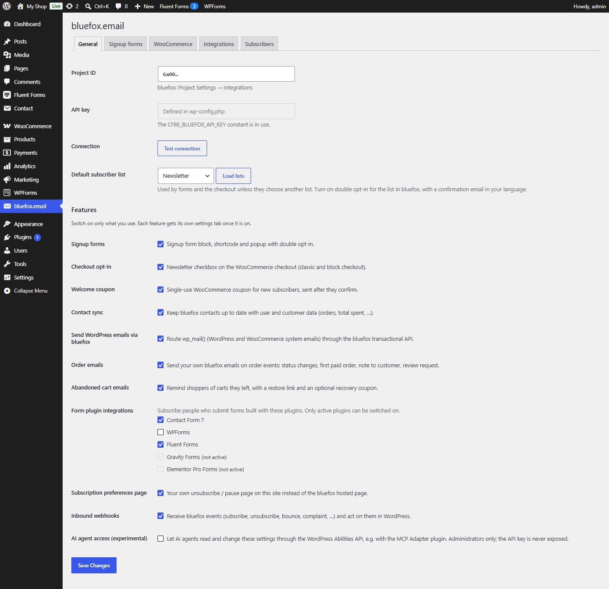

# General tab

Tab id: `api` · Options: `cfbe_api` (connection) and `cfbe_modules` (feature switches).

See [Connect to bluefox.email](../getting-started/connect.md) for a walkthrough.

## Connection

| Label | Option key | Default | What it does |
|---|---|---|---|
| Project ID | `cfbe_api[project_id]` | empty | Your bluefox project ID (*Project Settings → Integrations*). Only letters and digits are kept. |
| API key | `cfbe_api[api_key]` | empty | bluefox API key (*Project Settings → API Keys & Domain Whitelist*). A password field: the stored key is never shown, and an empty field on save keeps the stored key. Disabled with *Defined in wp-config.php* when the `CFBE_BLUEFOX_API_KEY` constant is set – the constant always wins. |
| Connection → **Test connection** | – | – | Checks the saved project ID and key against the bluefox API. Save first. |
| Default subscriber list | `cfbe_api[list_id]` | empty | The list used by forms, the popup, the checkout opt-in and form integrations unless they choose another one. **Load lists** fetches your lists (cached for a day, and refreshed whenever the [bluefox setup](#bluefox-setup) check runs) and marks the ones with double opt-in on. When the cache has expired, the selects show the names saved at the last load. A list ID that is not among the loaded lists is rejected and the previous value kept. The loaded lists are also remembered in the `cfbe_known_lists` option: a block or shortcode may only target these lists or a list chosen in the settings (see [Signup forms](../features/signup-forms.md#list-and-tags-per-form)). |

`cfbe_api[webhook_secret]` is stored here too but shown on the [Webhooks tab](webhooks.md). A missing or malformed secret is regenerated on save (32 letters and digits). The IP and erase settings of the [Privacy tab](privacy.md) are also stored in `cfbe_api`.

## Features

Each switch loads one module. A module that is off loads no code and shows no tab. See [Switch on features](../getting-started/features.md).

| Label | Option key | Default | What it does |
|---|---|---|---|
| Signup forms | `cfbe_modules[forms]` | on | Block, `[cfbe_form]`, `[cfbe_promo]`, `[cfbe_thankyou]` and the popup. Adds the Form, Popup, Emails and Shortcodes tabs. See [Signup forms](../features/signup-forms.md). |
| Checkout opt-in | `cfbe_modules[checkout]` | off | Newsletter checkbox on the classic and block checkout. Needs WooCommerce. See [Checkout opt-in](../features/checkout-opt-in.md). |
| Welcome coupon | `cfbe_modules[coupon]` | off | Single-use coupon for new subscribers after they confirm. Needs WooCommerce. See [Welcome coupon](../features/welcome-coupon.md). |
| Contact sync | `cfbe_modules[sync]` | off | Writes user and customer data to bluefox contacts. See [Contact sync](../features/contact-sync.md). |
| Send WordPress emails via bluefox | `cfbe_modules[mailer]` | off | Adds the Email delivery tab. Mail is only rerouted once you also tick **Send emails through bluefox** there. See [Email delivery](../features/email-delivery.md). |
| Order emails | `cfbe_modules[order_emails]` | off | Your bluefox emails on order events. Needs WooCommerce. See [Order emails](../features/order-emails.md). |
| Abandoned cart emails | `cfbe_modules[abandoned_cart]` | off | Cart reminders with an optional recovery coupon. Needs WooCommerce. See [Abandoned cart emails](../features/abandoned-carts.md). |
| Form plugin integrations | `cfbe_modules[integration_cf7]`, `[integration_wpforms]`, `[integration_fluentforms]`, `[integration_gravityforms]`, `[integration_elementor]` | off | One checkbox per form plugin: Contact Form 7, WPForms, Fluent Forms, Gravity Forms, Elementor Pro Forms. Only active plugins can be switched on. See [Form plugin integrations](../features/form-integrations.md). |
| Subscription preferences page | `cfbe_modules[preferences]` | on | The `[cfbe_preferences]` page. See [Preferences page](../features/preferences-page.md). |
| Inbound webhooks | `cfbe_modules[webhooks]` | on | Stores and processes bluefox events and adds the Webhooks tab. See [Inbound webhooks](../features/inbound-webhooks.md). |
| AI agent access (experimental) | `cfbe_modules[abilities]` | off | Registers the plugin's abilities for AI agents. Needs WordPress 6.9+. See [AI agent access](../features/ai-agent-access.md). |

A switch whose requirement is missing is disabled and shows *Requires WooCommerce.*, *Requires WordPress 6.9 or later.* or *(not active)*. If it was on, it stays saved as on and works again when the requirement returns.

## bluefox setup

*Since 1.1.0.* Below the features, the General tab checks the settings that live in your bluefox project and fixes them with one click. Each row shows a status – **Ready**, **Off**, or what is wrong.

| Row | Ready when | **Apply in bluefox** sets |
|---|---|---|
| Double opt-in of "*list*" – one row per list the plugin uses (default list, popup, checkout, coupon, form integrations) | double opt-in is on, the confirmation email contains `{{verifyLink}}` and the redirect link is this site's [thank-you page](emails.md) | double opt-in on, the **Confirmation email** you choose, and the thank-you page as redirect link. The list's confirmation title and message are kept. |
| Subscription preferences page – only with the [preferences page](../features/preferences-page.md) switch on | the project's **Custom subscription preferences URL** is this site's preferences page | that URL, when the checkbox is ticked |

The **Confirmation email** select lists the project's transactional emails. Only emails whose content contains `{{verifyLink}}` can be chosen – bluefox rejects any other email as a confirmation email (bluefox's own sample *Confirm Registration* uses `{{confirmUrl}}` and is greyed out). If none qualifies, create one on the [Email templates](../features/email-templates.md) tab. Choose **— Leave unchanged —** to skip a list.

Lists that are already set up as chosen are not changed. The check is cached for ten minutes; **Check again** reads bluefox anew. Applying also clears the [redirect link warning](emails.md#redirect-link-check).
