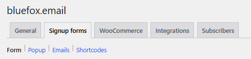

# Settings reference

All settings are under **bluefox.email** in the wp-admin menu (`wp-admin/admin.php?page=cfbe-newsletter`). Each tab has its own URL: `…&tab=<tab id>`.

The tabs are grouped under five main tabs; the sub-tabs of the active group are shown as links below them:

| Main tab | Sub-tabs |
|---|---|
| General | General |
| Signup forms | Form · Popup · Emails · Shortcodes |
| WooCommerce | Checkout · Coupon · Order emails · Abandoned carts |
| Integrations | Contact sync · Email delivery · Form integrations · Webhooks |
| Subscribers | Subscribers · Privacy · Logs |

A main tab only appears when at least one of its sub-tabs is switched on. Tabs added by other plugins appear under **More** unless they set a `group` key in the `cfbe_settings_tabs` filter.

Only administrators see the page by default. Developers can change the capability with the `cfbe_capability` filter (for example `manage_woocommerce` for shop managers).

| Tab | Tab id | Shown when | Option |
|---|---|---|---|
| [General](general.md) | `api` | always | `cfbe_api`, `cfbe_modules` |
| [Form](form.md) | `form` | Signup forms on | `cfbe_form` |
| [Popup](popup.md) | `popup` | Signup forms on | `cfbe_popup` |
| [Checkout](checkout.md) | `checkout` | Checkout opt-in on | `cfbe_checkout` |
| [Coupon](coupon.md) | `coupon` | Welcome coupon on | `cfbe_coupon` |
| [Contact sync](contact-sync.md) | `sync` | Contact sync on | `cfbe_sync` |
| [Email delivery](email-delivery.md) | `mailer` | Send WordPress emails via bluefox on | `cfbe_mailer` |
| [Emails](emails.md) | `emails` | Signup forms on | `cfbe_emails` |
| [Order emails](order-emails.md) | `woo_events` | Order emails on | `cfbe_woo_events` |
| [Abandoned carts](abandoned-carts.md) | `abandoned_cart` | Abandoned cart emails on | `cfbe_woo_events` |
| [Form integrations](form-integrations.md) | `integrations` | at least one form plugin integration on | `cfbe_integrations` |
| [Webhooks](webhooks.md) | `webhooks` | Inbound webhooks on | `cfbe_webhooks` |
| [Shortcodes](other-tabs.md#shortcodes) | `shortcodes` | Signup forms on | – |
| [Subscribers](other-tabs.md#subscribers) | `subscribers` | always | – |
| [Privacy](privacy.md) | `privacy` | always | `cfbe_api` |
| [Logs](other-tabs.md#logs) | `logs` | always | – |

## How settings are stored

- Each area is one array option, `cfbe_<area>`. The **Option key** column on each page uses the form field name, e.g. `cfbe_form[heading]`.
- Stored values are merged over the defaults, so a key you never saved has its default value.
- Every save goes through a sanitizer: unknown keys are dropped, numbers are clamped to their range and invalid choices fall back to the default. The ranges are listed on each page.
- Developers can add fields to an area with the `cfbe_settings_defaults_{area}` and `cfbe_sanitize_settings_{area}` filters – see [Hooks](../developers/hooks.md).

!!! tip "Text placeholders"
    `{discount}` in form, popup, promo and checkout texts is replaced with the welcome coupon value from the Coupon tab, e.g. `10%`.
