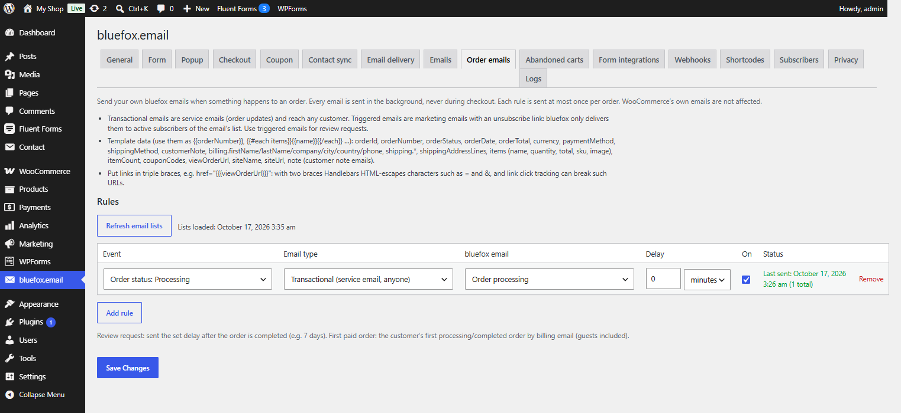

# Order emails tab

Tab id: `woo_events` · Option: `cfbe_woo_events[rules]` · Needs: **Order emails** and WooCommerce.

Send your own bluefox emails when something happens to an order. See [Order emails](../features/order-emails.md) for the events and [Email template data](../developers/template-data.md) for the template variables.

**Refresh email lists** loads your transactional and triggered emails from bluefox (stored in the `cfbe_woo_events_emails` option; loaded automatically the first time the tab opens).

## Rules

Each row is one rule. Up to 50 rules (shared with the [Abandoned carts tab](abandoned-carts.md)). **Add rule** adds a row, **Remove** deletes it.

| Column | Option key | Default for a new row | What it does |
|---|---|---|---|
| Event | `cfbe_woo_events[rules][n][event]` | *Order status: Completed* | `order_status_<status>` for every WooCommerce order status (custom statuses included), `first_order` (*First paid order of a customer*), `order_note_customer` (*Note to customer added*), `review_request` (*Review request (after the order is completed)*). |
| Email type | `cfbe_woo_events[rules][n][type]` | `transactional` | *Transactional (service email, anyone)* or *Triggered (marketing, active subscribers only)*. |
| bluefox email | `cfbe_woo_events[rules][n][email_id]` | empty | The bluefox email to send. An ID that belongs to the other email type is cleared. An ID no longer found in bluefox is kept and marked *(not found in bluefox)*. |
| Delay | `cfbe_woo_events[rules][n][delay]`, `[delay_unit]` | `0` `minutes` | Wait before sending. Units: minutes, hours, days. Max. one year. |
| On | `cfbe_woo_events[rules][n][enabled]` | on | A rule without an email is saved as off. |
| Status | – | – | *Last sent: &lt;time&gt; (&lt;n&gt; total)* and *Last error (&lt;time&gt;): &lt;message&gt;*. |

Each rule also has an internal `id` (8–16 lowercase letters and digits) that keeps its status and its "sent once per order" record when rows are reordered.

- Every email is sent in the background, never during checkout.
- Each rule is sent at most once per order.
- WooCommerce's own emails are not affected.
- **Review request** is sent the set delay after the order is completed (e.g. 7 days). Use a triggered email for it.
- **First paid order** is the customer's first processing or completed order, matched by billing email (guests included).
