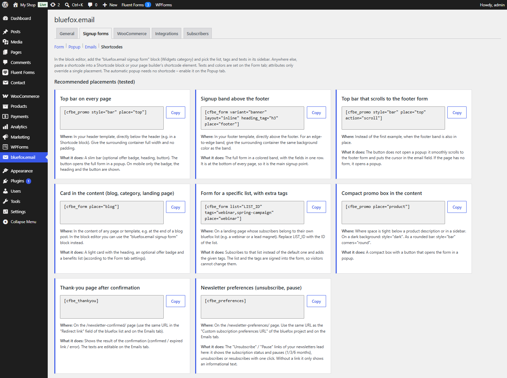

# Shortcodes, Subscribers and Logs

These tabs have no settings.

## Shortcodes

Tab id: `shortcodes` · Needs: **Signup forms**.

A ready-to-copy cookbook:

| Example | Code |
|---|---|
| Top bar on every page | `[cfbe_promo style="bar" place="top"]` |
| Signup band above the footer | `[cfbe_form variant="banner" layout="inline" heading_tag="h3" place="footer"]` |
| Top bar that scrolls to the footer form | `[cfbe_promo style="bar" place="top" action="scroll"]` |
| Card in the content (blog, category, landing page) | `[cfbe_form place="blog"]` |
| Form for a specific list, with extra tags | `[cfbe_form list="LIST_ID" tags="webinar,spring-campaign" place="webinar"]` |
| Compact promo box in the content | `[cfbe_promo place="product"]` |
| Thank-you page after confirmation | `[cfbe_thankyou]` |
| Newsletter preferences (unsubscribe, pause) | `[cfbe_preferences]` |

Each example says where to put it and what it does. Below them is the full attribute reference of every shortcode and an explanation of the `source-…`, `placement-…` and `interest-…` tags. The same reference is in [Shortcodes and block](../developers/shortcodes-block.md).

## Subscribers

Tab id: `subscribers` · Always shown.

A read-only log of signups stored in the `{prefix}cfbe_subscribers` table, 20 per page.

- **Check confirmations now** runs the confirmation check at once instead of waiting for the 15-minute poll, and queues coupons for confirmed subscribers.
- Filters: status, source and a search box.
- Columns: Email, Name, Source, Tags, Status, Subscribed (UTC), Confirmed (UTC), Coupon / order, Last error.

| Status | Meaning |
|---|---|
| Awaiting confirmation | bluefox sent the double opt-in email; not confirmed yet. |
| Confirmed | Confirmed, no coupon (coupon off, other list, or not eligible). |
| Coupon sent | Confirmed and the welcome coupon was sent. |
| Expired | Not confirmed within the confirmation deadline. A new signup for the address starts over. |
| Failed | bluefox rejected the address (e.g. suppressed or bounced, 405), or retries ran out. A new signup for the address starts over. |
| Already subscribed (no coupon) | The address was already an active (or paused) subscriber, or – with **One coupon per mailbox** – another address of the same mailbox already got a coupon (see *Last error*). |

A small *bluefox: paused / unsubscribed (time)* note shows later status changes reported by the preferences page or webhooks. For rows with a coupon, **Resend coupon email** sends the same code again.

Sources: Popup, Promo, Shortcode, Block, Checkout, My Account, Contact Form 7, WPForms, Fluent Forms, Gravity Forms, Elementor.

## Logs

Tab id: `logs` · Always shown.

The plugin's recent warnings and errors (all messages when WooCommerce is not active), up to 200 entries, stored in the `cfbe_log` option. Email addresses are masked wherever they appear in a log value, also inside bluefox error messages, and secrets are never logged. **Clear log** empties it.

With WooCommerce, the full log is under **WooCommerce → Status → Logs**, source `cfbe`.
