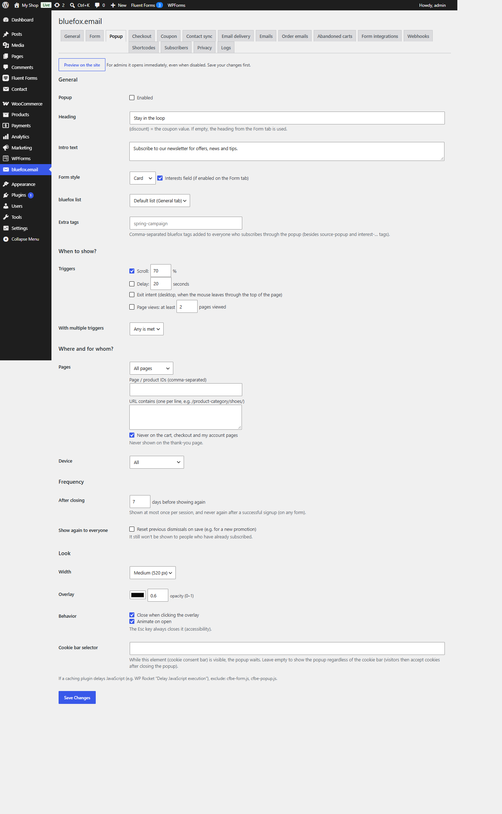

# Popup tab

Tab id: `popup` · Option: `cfbe_popup` · Needs: **Signup forms**.

**Preview on the site** opens the home page with `?cfbe_popup_preview=1`; for admins the popup opens at once there, even when it is disabled. Save first. See [Popup](../features/popup.md).

## General

| Label | Option key | Default | What it does |
|---|---|---|---|
| Popup → Enabled | `cfbe_popup[enabled]` | off | Shows the popup on the site. |
| Heading | `cfbe_popup[heading]` | *Stay in the loop* | Popup heading. Empty = the Form tab heading. `{discount}` is replaced. |
| Intro text | `cfbe_popup[intro]` | *Subscribe to our newsletter for offers, news and tips.* | Empty = the Form tab intro. |
| Form style | `cfbe_popup[form_variant]` | `card` | `card`, `banner` or `plain`. |
| Interests field (if enabled on the Form tab) | `cfbe_popup[show_interests]` | on | Hides the interests field in the popup when off. |
| bluefox list | `cfbe_popup[list_id]` | empty (default list) | List for popup signups. A dropdown once lists are loaded on the General tab, otherwise a text field for a list ID. An unknown list ID keeps the previous value. |
| Extra tags | `cfbe_popup[tags]` | empty | Comma-separated tags for everyone who subscribes through the popup, besides `source-popup` and the `interest-…` tags. |

## When to show?

| Label | Option key | Default | What it does |
|---|---|---|---|
| Triggers → Scroll | `cfbe_popup[trigger_scroll]`, `cfbe_popup[scroll_percent]` | on, `70` | After the visitor scrolls this percentage of the page. 10–100. |
| Triggers → Delay | `cfbe_popup[trigger_delay]`, `cfbe_popup[delay_seconds]` | off, `20` | After this many seconds on the page. 1–300. |
| Triggers → Exit intent | `cfbe_popup[trigger_exit]` | off | Desktop only, when the mouse leaves through the top of the page. |
| Triggers → Page views: at least | `cfbe_popup[trigger_pageviews]`, `cfbe_popup[pageviews]` | off, `2` | After this many pages viewed. 1–20. |
| With multiple triggers | `cfbe_popup[combine]` | `any` | `any` (*Any is met*) or `all` (*All are met*). |

At least one trigger must be on. If all are off, the scroll trigger is switched back on and a notice is shown.

## Where and for whom?

| Label | Option key | Default | What it does |
|---|---|---|---|
| Pages | `cfbe_popup[pages]` | `all` | `all` (*All pages*), `include` (*Only these*) or `exclude` (*All except these*). |
| Page / product IDs (comma-separated) | `cfbe_popup[page_ids]` | empty | Post, page or product IDs for *Only these* / *All except these*. |
| URL contains (one per line) | `cfbe_popup[url_contains]` | empty | URL fragments, e.g. `/product-category/shoes/`. |
| Never on the cart, checkout and my account pages | `cfbe_popup[exclude_woo]` | on | Never shows the popup on these WooCommerce pages. The thank-you page is always excluded. |
| Device | `cfbe_popup[device]` | `all` | `all`, `desktop` (*Desktop / tablet only*) or `mobile` (*Mobile only*). Decided in the browser. |

## Frequency

| Label | Option key | Default | What it does |
|---|---|---|---|
| After closing | `cfbe_popup[dismiss_days]` | `7` | Days before the popup is shown again to a visitor who closed it. 0–365. The popup is shown at most once per session and never after a successful signup. |
| Show again to everyone | `cfbe_popup[bump_version]` (not stored) | – | Tick and save to reset all previous dismissals. It increments the internal `cfbe_popup[version]` counter (default `1`). Subscribers still do not see the popup. |

## Look

| Label | Option key | Default | What it does |
|---|---|---|---|
| Width | `cfbe_popup[size]` | `md` | `sm` (*Narrow (420 px)*), `md` (*Medium (520 px)*), `lg` (*Wide (640 px)*). |
| Overlay → colour | `cfbe_popup[overlay_color]` | `#0a0a0a` | Hex colour of the backdrop. |
| Overlay → opacity (0–1) | `cfbe_popup[overlay_opacity]` | `0.6` | 0–1, rounded to two decimals. |
| Behavior → Close when clicking the overlay | `cfbe_popup[close_on_backdrop]` | on | Esc always closes the popup. |
| Behavior → Animate on open | `cfbe_popup[animate]` | on | Respects `prefers-reduced-motion`. |
| Cookie bar selector | `cfbe_popup[cookie_bar_selector]` | empty | CSS selector of your cookie consent bar, e.g. `#cookie-notice`. While it is visible, the popup waits. Max. 200 characters; `<`, `>`, `{`, `}` are removed. |

!!! tip "Delayed JavaScript"
    If a caching plugin delays JavaScript (for example WP Rocket's *Delay JavaScript execution*), exclude `cfbe-form.js` and `cfbe-popup.js`.
